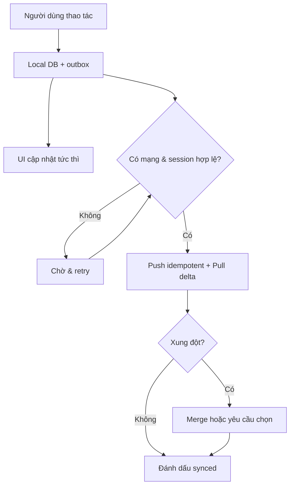

# CROSS-PLATFORM CAPSTONE — KNOWLEDGE & REQUIREMENTS PACK

> **Mục đích:** Tài liệu đầu vào (project context) để sinh viên và AI coding assistant/Codex hiểu những kiến thức đã học trong môn *Cross-Platform Mobile App Development*, chuyển chúng thành yêu cầu có thể triển khai và kiểm chứng trong đồ án.
>
> **Nguồn chính:** 5 PDF môn học của GV **Nguyễn Thanh Tuấn (VKU)**: Week 09, 10, 11, 12 và 13. **Ngày tổng hợp:** 09/11/2026.
>
> **Phân loại:** `[MÔN HỌC]` = được nêu trực tiếp trong slide; `[ĐỀ XUẤT]` = cách áp dụng/kiến thức bổ sung; `[CẦN XÁC NHẬN]` = phụ thuộc giảng viên, đề tài, phần cứng hoặc tài khoản triển khai.

---

## 0. CÁCH DÙNG FILE NÀY CHO DỰ ÁN

1. Đặt file này ở **thư mục gốc repository** và để AI đọc trước khi lên kế hoạch/sửa code.
2. Điền phần **Thông tin dự án** bên dưới. Các ví dụ `Record`, `records`, `AI scan` chỉ là mẫu, **không bắt buộc** làm app quản lý chi tiêu.
3. Áp dụng các yêu cầu `P0` trước; chỉ triển khai `P1/P2` nếu không ảnh hưởng tiến độ và chất lượng lõi.
4. Với mỗi tính năng, yêu cầu AI trả lời: **liên quan đến tuần học nào → thay đổi file nào → quy tắc nghiệp vụ → test → bằng chứng demo**.
5. Không coi các ví dụ phiên bản thư viện trong slide là phiên bản mới nhất; kiểm tra tài liệu chính thức và sự tương thích trước khi cài.

### Thông tin dự án — cần điền

| Trường | Giá trị |
|---|---|
| Tên ứng dụng | `TODO` |
| Vấn đề thực tế | `TODO` |
| Người dùng mục tiêu | `TODO` |
| 3 luồng cốt lõi | `TODO: đăng nhập → ... → ...` |
| Framework | `TODO: Flutter / React Native` |
| Android / iOS khả dụng | `TODO: thiết bị thật và hệ điều hành` |
| Backend | `TODO: Supabase / Firebase / backend riêng` |
| Local database | `TODO: SQLite / Isar / WatermelonDB / khác` |
| Tính năng on-device AI có giá trị thực | `TODO: OCR / barcode / face / pose / custom classifier` |
| Thành viên và thời gian còn lại | `TODO` |
| Những tính năng đã hoàn thành | `TODO` |

---

## 1. KẾT QUẢ CẦN ĐẠT & THANG ĐIỂM

### 1.1. Rubric bảo vệ cuối kỳ — **[MÔN HỌC]**

Theo **Week 13, tr. 3** (trùng với **Week 12, tr. 57**):

| Hạng mục | Trọng số | Minh chứng thực tế cần chuẩn bị |
|---|---:|---|
| **Practical Impact & Polish** | **30%** | Giải quyết vấn đề có thật; luồng người dùng hoàn chỉnh; không crash khi demo |
| **Clean Architecture & Code** | **25%** | Feature-first; presentation/domain/data tách biệt; quản lý state; DI, unit test |
| **On-device AI & Offline Resilience** | **20%** | AI chạy trên điện thoại; local DB; ghi offline và đồng bộ lại khi online |
| **Mobile UI/UX & 60fps** | **15%** | Responsive layout, dark mode, thao tác mượt, loading/empty/error states |
| **Presentation & Q&A** | **10%** | Trình bày đúng giờ, demo thiết bị thật, giải thích được code và quyết định kỹ thuật |

**Suy ra:** Trước khi thêm tính năng phụ, phải có **một luồng end-to-end hoàn chỉnh** nối từ UI → use case → repository → local/remote → (AI nếu phù hợp) → kiểm thử và demo. Đây là ưu tiên triển khai, không phải tiêu chí mới do giáo viên đưa ra.

### 1.2. Phân cấp ưu tiên cho backlog

- **P0 — Quan trọng nhất cho điểm môn học:** nghiệp vụ cốt lõi hoạt động; 3 lớp theo feature; test; backend + phân quyền; offline-first; on-device AI có quy trình review; UI hoàn chỉnh; release build; demo và hồ sơ nộp.
- **P1 — Tăng độ tin cậy:** sync queue bền vững, chống trùng bản ghi, xử lý xung đột, CI chất lượng, đo p50/p95 latency, crash reporting an toàn dữ liệu, accessibility, tài liệu kiến trúc/ERD.
- **P2 — Nâng cao nếu còn thời gian:** nhiều môi trường dev/staging/prod, beta distribution, Fastlane đầy đủ, giám sát sản phẩm, OTA update, model quantization/custom ML, bảo vệ model chuyên sâu.

**Không tự biến P2 thành điều kiện qua môn.** Các nội dung P2 có trong bài giảng ở mức giới thiệu/chuyên sâu, không phải tất cả đều được liệt kê là file phải nộp ở Week 12, tr. 56.

---

## 2. BẢN ĐỒ KIẾN THỨC THEO TỪNG TUẦN

| Tuần | Nội dung thực sự có trong slide | Đầu ra có thể kiểm chứng ở dự án |
|---|---|---|
| **09 — Architecture & Testing** | Dependency rule; domain/data/presentation; feature-first; repository; cache; `Either<Failure,T>`; DI; unit/widget/E2E tests; AI coding theo hợp đồng và test | Cấu trúc `features/<feature>/{domain,data,presentation}`; use case; repository interface + implementation; mock tests; UI tests; 1 E2E flow |
| **10 — Backend** | Supabase vs Firebase; JWT refresh; PostgreSQL RLS; offline DB; sync hai chiều; Last-Write-Wins/field merge/manual conflict; secure storage, SSL pinning, obfuscation | Auth, phân quyền theo tài khoản, local DB, thử ghi offline và sync khi có mạng, không lộ token/secret |
| **11 — On-device AI** | Edge vs cloud; ML Kit OCR/face/pose/barcode; Core ML; TFLite; ONNX; camera throttling; regex parser; human review; latency; privacy | AI chạy không cần cloud inference, hậu xử lý, màn hình xác nhận trước lưu, benchmark nhiều lần trên thiết bị thật |
| **12 — Release & Ops** | Debug/profile/release; version/flavor; ký Android/iOS; `.apk/.aab/.ipa`; GitHub Actions, Fastlane/EAS; OTA; store checks; Crashlytics/Sentry; hồ sơ bảo vệ | APK ký release; CI lint/test/build; README; hướng dẫn cài; tránh commit secrets; log lỗi có chọn lọc; tài liệu và video demo |
| **13 — Defense** | Trình bày, live demo Android/iOS, code review, kiểm tra edge AI/offline, 5 tiêu chí chấm | Demo mạch lạc; trả lời vì sao kiến trúc/AI/sync/test đã thiết kế như vậy |

**Lưu ý nguồn:** Week 10 chỉ có **6 trang**, đa phần là agenda và ví dụ RLS/chiến lược xung đột; các chi tiết kỹ thuật như refresh JWT, lưu token an toàn và đồng bộ bền vững dưới đây là **đề xuất triển khai thêm**, không phải code được hướng dẫn đầy đủ trong PDF.

---

## 3. YÊU CẦU KỸ THUẬT CỐT LÕI (P0)

### A. Kiến trúc sạch theo tính năng

**[MÔN HỌC — Week 09, tr. 7–16, 52–54]**

- [ ] Toàn bộ tính năng quan trọng được tổ chức **feature-first**, mỗi tính năng có `domain`, `data`, `presentation`.
- [ ] `domain`: business entities/value objects, repository **contracts/interfaces**, use cases; không import widget, Dio/HTTP, database SDK.
- [ ] `data`: DTO/model JSON, `RemoteDataSource`, `LocalDataSource`, `RepositoryImpl`, mapping entity/model, xử lý lỗi hạ tầng.
- [ ] `presentation`: screen/widget, state manager (Riverpod/Provider/BLoC/Zustand...), mapping state `loading/empty/success/error`.
- [ ] UI **không trực tiếp truy cập** Supabase, HTTP, SQLite, ML Kit. Những SDK này nằm trong adapter/service của tầng data hoặc module hạ tầng tương ứng.
- [ ] Repository là điểm truy cập dữ liệu thống nhất; có thể thay API/local DB mà không sửa nghiệp vụ.
- [ ] Có dependency injection (ví dụ GetIt/Riverpod provider graph hoặc cơ chế tương đương trong React Native), kiểm thử được bằng fake/mock.
- [ ] Luồng lỗi rõ ràng (`Result`/`Either`/sealed states), không `catch` mọi lỗi rồi im lặng.

**Nguyên tắc thiết kế:**

```text
Presentation: Screen → ViewModel/Notifier → UseCase
Domain:       UseCase → Repository interface + Entity
Data:         RepositoryImpl → RemoteDataSource / LocalDataSource
Dependencies: Presentation → Domain ← Data
```

**[ĐỀ XUẤT]** Thêm `core/` cho cấu hình, lỗi, mạng, giao diện và DI; tránh dựng class trung gian nếu không giải quyết trách nhiệm thật. **Ưu tiên 3 lớp vì môn học yêu cầu**, dù tài liệu Flutter chính thức xem domain layer là tùy độ phức tạp ứng dụng.

#### Mẫu cấu trúc Flutter

```text
lib/
├── app/                         # router, app bootstrap, theme
├── core/
│   ├── config/                  # environment, endpoint
│   ├── di/                      # setup dependencies
│   ├── errors/                  # Failure/Exception
│   ├── network/                 # connectivity, API client
│   └── ui/                      # reusable components
├── features/
│   ├── auth/
│   │   ├── domain/              # User, AuthRepository, LoginUseCase...
│   │   ├── data/                # AuthRemoteDataSource, AuthRepoImpl...
│   │   └── presentation/        # LoginScreen, AuthNotifier...
│   ├── records/                 # THAY bằng tính năng nghiệp vụ của bạn
│   │   ├── domain/{entities,repositories,usecases}/
│   │   ├── data/{models,datasources,repositories}/
│   │   └── presentation/{screens,widgets,providers}/
│   └── ai_assistant/            # SDK adapter + parser + review UX
└── main.dart
test/                            # mirror lib/features/...
integration_test/                # full-flow tests
.github/workflows/               # CI
docs/                            # architecture, ERD, screenshots, demo
```

**React Native:** dùng cấu trúc tương đương `src/features/*/{domain,data,presentation}`, TypeScript interfaces, state manager thích hợp, test bằng Jest/React Native Testing Library, E2E bằng Maestro. Không sao chép package Flutter sang React Native.

**Nghiệm thu:** Chỉ cần mở một feature bất kỳ, thành viên giải thích được đường đi dữ liệu và sửa backend mà không sửa screen/business rules.

### B. Backend, authentication và bảo mật dữ liệu

**[MÔN HỌC — Week 10, tr. 2–4]**

- [ ] Có backend phù hợp (Supabase/Firebase hoặc giải pháp tương đương) và auth cho dữ liệu theo người dùng.
- [ ] Mỗi bản ghi riêng tư gắn `owner_id`/`user_id`; backend bắt buộc kiểm tra quyền truy cập theo user.
- [ ] Nếu dùng Supabase/Postgres: bật **Row-Level Security (RLS)** và kiểm thử không thể đọc/sửa bản ghi của tài khoản khác.
- [ ] Có chiến lược dùng/refresh session; không lưu password/token vào code hoặc log.
- [ ] Không chứa service-role/private API keys, signing keys, `.env` thật trong repository/ứng dụng client.

**[ĐỀ XUẤT]** Ví dụ chính sách RLS riêng cho đọc/ghi (chỉ điều chỉnh sau khi tạo bảng `records(owner_id uuid ...)` và xác định quyền nghiệp vụ):

```sql
ALTER TABLE public.records ENABLE ROW LEVEL SECURITY;

CREATE POLICY "read own records" ON public.records
  FOR SELECT TO authenticated
  USING ((SELECT auth.uid()) = owner_id);

CREATE POLICY "insert own records" ON public.records
  FOR INSERT TO authenticated
  WITH CHECK ((SELECT auth.uid()) = owner_id);

CREATE POLICY "update own records" ON public.records
  FOR UPDATE TO authenticated
  USING ((SELECT auth.uid()) = owner_id)
  WITH CHECK ((SELECT auth.uid()) = owner_id);

CREATE POLICY "delete own records" ON public.records
  FOR DELETE TO authenticated
  USING ((SELECT auth.uid()) = owner_id);
```

**Cảnh báo:** Đây là policy **minh họa**, không áp dụng nguyên xi nếu có chia sẻ dữ liệu giữa phụ huynh/bác sĩ, người bán/người mua, admin… Mọi quan hệ phân quyền phải được thiết kế và kiểm thử riêng. Các token nhạy cảm nên do SDK auth xử lý vòng đời và lưu trong cơ chế bảo vệ phù hợp với nền tảng (Keychain/Keystore qua thư viện có bảo trì). Không đưa secret vào Dart define vì client có thể bị phân tích ngược.

**Test bảo mật tối thiểu:** User A đăng nhập → tạo dữ liệu → User B đăng nhập → truy xuất ID của A phải bị từ chối/không trả bản ghi; thử insert/update dùng `owner_id` của A bằng session B cũng phải thất bại.

### C. Offline-first và đồng bộ 2 chiều

**[MÔN HỌC — Week 09, tr. 18–21; Week 10, tr. 5–6; Week 11, tr. 55]**

- [ ] App mở và xem dữ liệu đã cache khi bật Airplane Mode.
- [ ] Người dùng **tạo/chỉnh sửa dữ liệu quan trọng khi offline**; thao tác được lưu bền vững trong local DB, không chỉ giữ trong RAM.
- [ ] Có trạng thái `pending/syncing/synced/failed` hoặc tương đương, dễ nhận biết khi lỗi đồng bộ.
- [ ] Khi online trở lại, đẩy tác vụ chưa đồng bộ; kéo thay đổi mới từ server; tránh tạo trùng khi retry.
- [ ] Có quy tắc xử lý xung đột khi 2 thiết bị sửa cùng bản ghi.
- [ ] UI luôn lấy dữ liệu qua repository, không tự phân nhánh `if online` trong các widget.

**[ĐỀ XUẤT]** Mô hình đơn giản, minh bạch:



**Local record gợi ý:** `id` (UUID sinh tại client), `owner_id`, các trường nghiệp vụ, `updated_at`, `server_version`, `deleted_at` (tombstone), `sync_status`. **Outbox:** `operation_id`, `entity_id`, `type`, `payload`, `created_at`, `attempt_count`, `last_error`. Tên trường chỉ là mẫu cho thiết kế schema riêng.

**Chọn chiến lược xung đột:**

| Chiến lược | Khi phù hợp | Rủi ro/cách giảm thiểu |
|---|---|---|
| Last-Write-Wins | Dữ liệu ít quan trọng, cập nhật nhỏ | Có thể ghi đè; ưu tiên version/timestamp từ server, không tin tuyệt đối đồng hồ client |
| Field-level merge | Hai thiết bị sửa những trường khác nhau | Cần theo dõi từng field và quy tắc merge |
| Manual conflict | Dữ liệu nhạy cảm/quan trọng, hai bản sửa cùng field | Phải có màn hình so sánh và lựa chọn |

**Case test demo:** (1) Có mạng tạo bản ghi; (2) bật máy bay, thêm/chỉnh sửa; (3) tắt app/mở lại vẫn còn; (4) bật mạng và đồng bộ; (5) không trùng bản ghi; (6) đăng nhập thiết bị khác thấy dữ liệu; (7) hai thiết bị sửa cùng bản ghi có cách giải quyết; (8) lỗi HTTP/server không làm mất outbox.

### D. On-device AI — dùng thật, không chỉ gọi cloud LLM

**[MÔN HỌC — Week 11, tr. 9–20, 28–47, 49–55]**

- [ ] Chọn **một tác vụ AI có ích cho đề tài** và chạy inference trực tiếp trên điện thoại: ML Kit (OCR/barcode/face/pose…) hoặc TFLite/Core ML/custom model.
- [ ] Có quy trình `input/camera → inference → xử lý hậu kỳ → người dùng kiểm tra/sửa → lưu local`.
- [ ] Chuyển dữ liệu thô thành cấu trúc có ý nghĩa bằng regex/rules/validation phù hợp đề tài (không nhất thiết là hóa đơn).
- [ ] Trước khi lưu dữ liệu AI dự đoán, có màn hình **human-in-the-loop** và cho phép sửa; nếu có confidence đáng tin, hiển thị kèm nhãn phù hợp.
- [ ] AI chạy được khi offline (xác định rõ model cần được cài/bundled trước); có test không Internet.
- [ ] Đo latency thực tế theo thiết bị; báo cáo ít nhất số mẫu, trung bình hoặc p50, p95, đơn vị ms, điều kiện đo.
- [ ] Không block UI bằng tiền xử lý nặng; đóng camera/interpreter/recognizer khi không dùng; quản lý permission và lifecycle.

**Ví dụ chọn tính năng theo lĩnh vực — [ĐỀ XUẤT]:**

| Đề tài | Edge AI phù hợp | Human review |
|---|---|---|
| Theo dõi tiêm chủng | OCR đọc thông tin trên phiếu/nhãn, quét barcode vắc-xin (nếu hợp lệ) | Người dùng xác minh tên/ngày/lô trước khi lưu |
| Chăm sóc người cao tuổi | Face detection/pose hoặc mô hình custom phân tích chuyển động | Xác nhận sự kiện, tránh tự động kết luận y khoa |
| Quản lý tài chính | OCR biên lai; regex số tiền/ngày | Sửa tên cửa hàng, số tiền, ngày |
| Quản lý học tập | OCR ảnh ghi chú/thẻ sinh viên | Sửa văn bản trước khi lưu/tìm kiếm |
| Kho hàng/sản phẩm | Barcode/QR và OCR nhãn | Xác minh mã, số lượng |

**Quy tắc kỹ thuật đề xuất:** Với camera stream, dùng `frame throttle` + một `processing lock`, bỏ frame khi engine đang bận; xử lý ảnh nặng ngoài main UI thread khi phù hợp; tính đúng camera rotation; bắt đầu thử khoảng **400 ms/frame** theo ví dụ Week 11, tr. 42 rồi điều chỉnh bằng benchmark; giải phóng native resource (`close`/`dispose`) đúng vòng đời.

**Tránh hiểu nhầm:** Các con số tốc độ/độ chính xác trong slide là ví dụ hoặc benchmark phụ thuộc thiết bị/model; **không cam kết** sản phẩm của bạn đạt dưới 20 ms hay 60 fps nếu chưa đo. Không lưu ảnh sinh trắc nhạy cảm hoặc gửi lên cloud nếu không cần thiết; nếu có cloud fallback, cần sự đồng ý rõ ràng.

### E. UI/UX đa nền tảng và độ mượt

**[MÔN HỌC — Week 12, tr. 57; Week 13, tr. 3]**

- [ ] Luồng chính đi hết được, không còn placeholder, nút chết, màn hình trắng.
- [ ] Có light/dark theme và layout phù hợp nhiều kích thước điện thoại; thử tablet nếu có.
- [ ] Các màn hình có trạng thái **loading, empty, error, success** và retry hợp lý.
- [ ] Camera/AI có trạng thái xin quyền, từ chối quyền, đang xử lý, kết quả, xác nhận.
- [ ] Nút quan trọng có phản hồi; tránh double-submit; thao tác offline có nhãn trạng thái.
- [ ] Thử hiệu năng bằng **profile/release build** trên máy thật, kiểm tra dropped frames/jank và thao tác 60fps theo khả năng thiết bị.

**[ĐỀ XUẤT]** Thêm accessibility labels, độ tương phản, cỡ chữ phóng to, các thông báo lỗi dễ hiểu và skeleton/placeholder phù hợp. Tập trung sự mượt của **luồng chính**, không lạm dụng animation.

### F. Testing — bộ chứng cứ kỹ thuật

**[MÔN HỌC — Week 09, tr. 31–43, 53–54]**

| Loại test | Mục tiêu | Test nên có |
|---|---|---|
| **Unit** | Business rule/use case/parser | Input hợp lệ, input rỗng, ranh giới, parse lỗi; dùng mock repository |
| **Repository/data** | Điều phối local/remote | Online success; offline cached; server timeout; queue retry; mapping lỗi |
| **Widget/component** | UI state/tương tác | Loading, empty, error, data hiển thị; nút save/delete gọi đúng notifier |
| **E2E** | Luồng như người dùng thật | Đăng nhập → tính năng chính → review AI → lưu → offline → online sync |

**Yêu cầu lab Week 09, tr. 54:** ít nhất **1 entity + 1 use case + 1 repo contract; 1 data model + 1 repo implementation; 1 notifier + 1 screen; ≥2 unit tests và ≥1 widget test** cho bài lab refactor, chạy `flutter test` xanh. Đây là **mức tối thiểu của lab**, không đại diện cho mức test đủ để đạt điểm capstone tối đa.

**[ĐỀ XUẤT]** Mục tiêu capstone thực dụng:

- [ ] Unit test cho mọi business rule quan trọng, bao gồm failure branches.
- [ ] Test repository online/offline/outbox.
- [ ] Test RLS bằng hai user thật trong môi trường test.
- [ ] Widget tests cho các trạng thái chính.
- [ ] Một E2E luồng hoàn chỉnh trên thiết bị/emulator và một bản **demo thực** trên điện thoại.
- [ ] Kết quả test, ảnh chụp CI và benchmark có thể trình bày trong báo cáo.

### G. CI/CD, bảo mật release và kiểm soát chất lượng

**[MÔN HỌC — Week 12, tr. 5–15, 26–34, 48–56]**

- [ ] GitHub repository sạch, README hướng dẫn setup/run/test/build.
- [ ] CI trên pull request: cài dependencies → lint/static analysis → unit/widget tests → báo lỗi nếu fail.
- [ ] Quản lý version dạng `major.minor.patch+buildNumber`, release tag ví dụ `v1.0.0`.
- [ ] Có **signed release artifact** phù hợp Android (`.apk` để cài demo, `.aab` nếu nộp Play Store) và/hoặc iOS (`.ipa` nếu đủ tài khoản/môi trường ký).
- [ ] File keystore/cert/key/password không commit lên Git; đặt trong secret store phù hợp.
- [ ] Đảm bảo demo chạy trên bản gần release thay vì chỉ `flutter run` ở debug.
- [ ] Có ghi nhận lỗi (Crashlytics/Sentry hoặc giải pháp tương đương) **nếu triển khai**, ẩn PII/token trong log.

**Phân biệt:** Để bảo vệ môn học, **nộp artifact release** theo Week 12 tr. 56 là yêu cầu rõ ràng; **đẩy công khai lên App Store/Google Play** không được nêu như một trong 5 file phải nộp. TestFlight, store production, OTA/Shorebird, ASO thuộc nội dung kiến thức và phần nâng cao tùy tài khoản/phạm vi dự án.

---

## 4. MVP THAM CHIẾU: MỘT TÍNH NĂNG XUYÊN SUỐT CÁC LỚP

**[ĐỀ XUẤT]** Dùng một loại dữ liệu nghiệp vụ `Record` (đổi thành `Vaccination`, `Booking`, `Note`, `Expense`, `CareEvent`...) để kết nối tất cả các chủ đề đã học.

### Luồng người dùng mẫu

1. User đăng nhập → backend cấp session → local database mở dữ liệu đúng tài khoản.
2. User xem danh sách bản ghi từ local DB ngay cả khi mất mạng; app làm mới từ server khi online.
3. User tạo bản ghi thủ công **hoặc** từ camera/AI → parse → chỉnh sửa → xác nhận.
4. App ghi vào local DB cùng một outbox operation, cập nhật UI ngay.
5. Sync worker có mạng mới đẩy operation lên remote bằng ID ổn định; RLS ngăn user khác truy cập.
6. Sau thành công, app đánh dấu `synced`, tải delta server, refresh local.
7. Thử sửa offline trên 2 thiết bị, xử lý conflict theo quy tắc đã công bố.
8. Test unit/parser, widget states, sync, security và E2E; CI chạy tự động.
9. Build APK release ký, cài điện thoại và trình diễn quy trình.

### Hợp đồng kỹ thuật tối thiểu

| Thành phần | Trách nhiệm | Ví dụ tên |
|---|---|---|
| Entity | Quy tắc, ID, thuộc tính nghiệp vụ | `Record` |
| Repository contract | API thuần cho use case | `RecordRepository` |
| Use case | Một thao tác nghiệp vụ | `CreateRecord`, `GetRecords`, `SyncPendingRecords` |
| Remote data source | Authenticated API/backend CRUD | `RecordRemoteDataSource` |
| Local data source | SQLite/Isar read/write/transaction | `RecordLocalDataSource` |
| Repository impl | Cache, sync, mapping lỗi | `RecordRepositoryImpl` |
| AI adapter | MLKit/TFLite, trả kết quả thô | `OnDeviceAnalyzer` |
| Parser/validator | Chuẩn hóa kết quả AI thành draft | `ParseRecordDraft` |
| State notifier/view model | UI state/action | `RecordNotifier` |
| Screen | Hiển thị, input, review | `RecordListScreen`, `ReviewDraftScreen` |

### Checklist định nghĩa hoàn thành cho mỗi tính năng (Definition of Done)

- [ ] Có mô tả user story, tiêu chí thành công, các ngoại lệ.
- [ ] Domain contract và use case được xác định trước.
- [ ] Data model/map giữa local ↔ entity ↔ remote đúng; migration dữ liệu nếu cần.
- [ ] UI đủ loading/empty/error/success, không giữ logic HTTP/SQL.
- [ ] Offline behavior rõ ràng (được dùng hay yêu cầu online với lý do).
- [ ] Auth/RLS/quyền xem–sửa đã kiểm tra.
- [ ] Ít nhất test happy path **và** failure/edge case phù hợp.
- [ ] `analyze/lint/test` chạy xanh, không hard-code secret.
- [ ] Đã thử trên điện thoại và ghi kết quả, ảnh/video nếu tính năng demo.
- [ ] README/diagram/báo cáo cập nhật.

---

## 5. LỘ TRÌNH TRIỂN KHAI ĐỀ XUẤT

| Giai đoạn | Làm gì | Điều kiện để chuyển giai đoạn |
|---|---|---|
| **M1 — Định nghĩa** | Chốt user personas, 3 luồng quan trọng, feature list, ERD, flow, stack, RLS roles | Có backlog P0/P1/P2 và demo script thô |
| **M2 — Kiến trúc** | Feature-first, DI, entity/interface/use case, test cơ bản, state UI | Một feature CRUD có test và không gọi API trực tiếp trong screen |
| **M3 — Data & offline** | Auth, RLS, local cache, outbox, sync, conflict policy | Demo airplane mode và sync không mất/trùng dữ liệu |
| **M4 — AI & polish** | On-device ML, parse, review, benchmark, dark mode, responsive, test edge cases | AI chạy offline; người dùng sửa được kết quả; có bảng latency |
| **M5 — Release & defense** | CI, signed APK, crash checks, README, report, slides, video, rehearsal | Artifact tải/cài được; mọi minh chứng và backup demo sẵn sàng |

**Quy tắc dừng mở rộng:** Khi P0 chưa hoàn tất hoặc kiểm thử chưa ổn định, không thêm AI chatbot/cloud LLM/OTA/dashboard admin chỉ để tăng số lượng tính năng. Nếu chatbot thực sự là chức năng lõi, vẫn giữ yêu cầu **on-device** riêng để chứng minh Week 11.

---

## 6. HỒ SƠ NỘP VÀ DEMO BẢO VỆ

### 6.1. Năm hạng mục nộp — **[MÔN HỌC — Week 12, tr. 56]**

- [ ] **Final Report:** PDF **25–40 trang**, chương 1–6 theo template Report 4 của giảng viên.
- [ ] **Defense slides:** PDF **10–12 slide**, thiết kế cho bài trình bày gọn.
- [ ] **Signed release binary:** `.apk`/`.aab` release, gắn vào GitHub Releases tag `v1.0.0`.
- [ ] **GitHub repo sạch:** source code, `.github/workflows`, `Fastfile` (hoặc giải pháp build tương đương phù hợp stack), `README.md`.
- [ ] **Video demo thiết bị thật:** **3–5 phút**, **1080p**, MP4 hoặc video URL, không quay emulator thay cho demo được yêu cầu.

**Report 3 Week 11, tr. 55:** working on-device AI; heuristic post-processing; editable human review + confidence indicator; offline local persistence + sync queues; latency benchmark. Ghi riêng các mục này trong báo cáo.

### 6.2. Demo đề xuất theo thứ tự ăn điểm

1. **30–45 giây:** vấn đề thực tế, người dùng, giá trị của app.
2. **60–90 giây:** đăng nhập, màn hình chính, bản ghi thực tế có sẵn.
3. **60–90 giây:** gọi camera/AI trên điện thoại, sửa kết quả, lưu.
4. **60–90 giây:** bật Airplane Mode, vẫn xem/tạo dữ liệu; bật mạng, tự đồng bộ.
5. **30–45 giây:** dark mode, trạng thái lỗi/loading, responsiveness.
6. **60 giây:** sơ đồ 3 lớp, RLS test, CI xanh, unit/widget/E2E test, latency, APK release.

**Chuẩn bị:** 1 thiết bị Android thực và iPhone nếu nhóm có điều kiện; dây USB/mirroring, dữ liệu mẫu có ý nghĩa, vật mẫu để quét, tài khoản demo, video dự phòng. **Không khẳng định đã test iOS nếu chưa có máy hoặc build iOS hợp lệ.**

### 6.3. Chênh lệch về thời lượng trong slide — **[CẦN XÁC NHẬN]**

- **Week 12, tr. 56–58:** gợi ý trình bày 12–15 phút và một lịch mẫu 15 phút tính cả demo/Q&A.
- **Week 13, tr. 2:** nêu oral presentation **10–12 phút/nhóm** và live demonstration **3–5 phút**.
- **Hành động:** hỏi giảng viên thời lượng chính thức, có tính demo vào thời gian thuyết trình hay không, và yêu cầu Android/iOS khi nhóm không sở hữu thiết bị Apple.

### 6.4. Câu hỏi bảo vệ cần trả lời được

1. Tại sao app dùng Flutter/React Native? Phần nào thực sự dùng chung code giữa Android/iOS?
2. Tại sao dùng feature-first và 3 lớp? Lấy một thao tác truy vết qua các file.
3. Domain tại sao không import package mạng/DB/UI?
4. Repository làm gì khi offline, timeout, dữ liệu cache cũ? Vì sao chọn policy cache này?
5. Khi hai máy sửa cùng bản ghi, điều gì xảy ra? Dữ liệu nào có thể bị ghi đè?
6. User B có thể đọc ID dữ liệu của User A không? Test RLS ở đâu?
7. AI chạy trên thiết bị ở đâu? Có truyền ảnh lên server không? Làm sao chứng minh offline?
8. Có xử lý AI sai kết quả như thế nào? Có review trước lưu không?
9. AI latency đo ở máy nào và bao nhiêu lần? Vì sao xử lý frame throttle?
10. Test unit/widget/E2E đã bắt được lỗi gì thật? CI có chặn merge khi fail không?
11. Tại sao APK release khác debug? Đã bảo vệ signing secrets như thế nào?
12. Nếu demo mất mạng/camera không được cấp quyền, app phản ứng ra sao?

---

## 7. TÀI LIỆU MỞ RỘNG — PHÂN BIỆT VỚI SLIDE MÔN HỌC

Các liên kết sau là **nguồn chính thức** để tự nghiên cứu cách triển khai hiện hành; thông tin có thể thay đổi theo phiên bản SDK và chính sách cửa hàng.

| Chủ đề | Nên đọc gì | Link |
|---|---|---|
| Kiến trúc Flutter | UI/data separation, repositories, domain optional (nhưng **rubric môn này yêu cầu 3 lớp**) | https://docs.flutter.dev/app-architecture/guide |
| Kiểm thử Flutter | Unit, widget, integration | https://docs.flutter.dev/testing/overview |
| Đo performance | Profile mode; jank/frame timing | https://docs.flutter.dev/perf/ui-performance |
| Supabase RLS | `auth.uid()`, `USING`/`WITH CHECK`, policy cho authenticated | https://supabase.com/docs/guides/database/postgres/row-level-security |
| Supabase secure data | Auth, RLS, bảo vệ truy cập dữ liệu | https://supabase.com/docs/guides/database/secure-data |
| Google ML Kit | Các tác vụ AI chạy trên máy | https://developers.google.com/ml-kit |
| ML Kit & dữ liệu | Data collection của SDK và thông tin cần khai báo | https://developers.google.com/ml-kit/android-data-disclosure |
| Flutter release | Android/iOS build và phát hành | https://docs.flutter.dev/deployment |
| Fastlane | Mobile release automation | https://docs.fastlane.tools |
| Expo EAS | Nếu chọn React Native/Expo | https://docs.expo.dev/eas/ |

### Cảnh báo khi đọc ví dụ trong slide

- **Version package, API target, cửa hàng, giá/tài khoản, reviewer policy** có thể đã đổi; xác minh ở trang chính thức ngay trước khi thực hiện.
- **Benchmark** trong slide (ví dụ độ trễ AI, kích thước app, tỉ lệ crash, số FPS) là bối cảnh học tập, **không phải số đo dự án**.
- **Bảo mật:** on-device processing không mặc nhiên có nghĩa SDK hoàn toàn không thu thập chẩn đoán/metadata; kiểm tra tài liệu quyền riêng tư của SDK.
- **Offline:** chỉ `network-first` fallback cache chưa đảm bảo **ghi offline và sync hai chiều**; cần outbox/retry/conflict có kiểm thử.
- **Release:** obfuscation giúp khó đảo ngược hơn nhưng **không làm bí mật embedded key an toàn**; secrets phải được giữ phía server hoặc trong cơ chế quản lý khóa phù hợp.
- **AI:** không xem gọi OpenAI/Gemini API là thay thế hoàn toàn cho yêu cầu on-device AI của bài bảo vệ.

---

## 8. PROMPT DÙNG NGAY CHO CODEX/AI CODING ASSISTANT

> Bạn có thể copy khối này vào Codex khi đã đặt file `.md` ở root của dự án.

```text
Hãy đọc toàn bộ CROSS_PLATFORM_CAPSTONE_KNOWLEDGE_PACK.md trước khi hành động.
Đây là dự án môn Cross-Platform Mobile App Development của VKU.

Mục tiêu:
1. Tuân thủ kiến thức Week 09–13 và rubric trong file; phân biệt [MÔN HỌC] và [ĐỀ XUẤT].
2. KHÔNG viết lại dự án, thay stack hay xóa code hiện có khi chưa kiểm tra repo.
3. Bắt đầu bằng audit read-only: tech stack, source tree, luồng hiện tại,
   architecture, auth/RLS, local DB/sync, edge AI, tests, CI/release, UI.
4. Xuất GAP ANALYSIS có cột: yêu cầu, evidence path, hiện trạng
   (done/partial/missing/blocked), ưu tiên P0/P1/P2, rủi ro, việc nhỏ tiếp theo.
5. Hỏi tôi thông tin đề tài/thiết bị/stack còn thiếu trước các quyết định lớn.
6. Sau khi thống nhất, triển khai theo từng lát feature-first:
   domain contract → use case → data adapters → presentation → tests → docs.
7. Mỗi thay đổi phải nêu file sửa, lý do, cách test, test output,
   rủi ro security/privacy, và cách chứng minh trong demo.
8. Không hard-code secrets hoặc API private keys; mọi data của user phải
   được phân quyền backend, không chỉ filter ở UI.
9. Không khẳng định AI chạy on-device/offline, sync an toàn, 60fps, iOS hỗ trợ
   hoặc test đã pass nếu chưa kiểm chứng bằng thiết bị/log/CI thật.

Trước tiên hãy trả về bản GAP ANALYSIS và kế hoạch 5 milestone;
chưa sửa code cho đến khi tôi xác nhận phạm vi.
```

### Mẫu theo dõi tiến độ có thể copy vào issue/README

| ID | Requirement | Source | P | Status | Evidence | Owner | Next action |
|---|---|---|---|---|---|---|---|
| ARCH-01 | Feature-first + strict 3 layers | W09 p.9, 52 | P0 | TODO | `lib/features/...` | TODO | Audit imports |
| TEST-01 | Unit/Widget/E2E | W09 p.31–43 | P0 | TODO | `test/`, `integration_test/` | TODO | Test use case |
| AUTH-01 | Auth + RLS | W10 p.2–4 | P0 | TODO | policies, cross-user test | TODO | Define roles |
| SYNC-01 | Offline persistent writes + sync | W10 p.5–6; W11 p.55 | P0 | TODO | airplane demo | TODO | Build outbox |
| AI-01 | Edge AI + review + benchmark | W11 p.55 | P0 | TODO | device video, latency table | TODO | Select task |
| UX-01 | Dark mode + responsive + states | W13 p.3 | P0 | TODO | screenshots | TODO | Audit UI |
| REL-01 | Signed binary + CI + repo | W12 p.56 | P0 | TODO | GitHub Release/CI | TODO | Prepare pipeline |
| DEF-01 | 5 final submissions + rehearsal | W12 p.56; W13 p.2 | P0 | TODO | PDF, MP4, app demo | TODO | Assign owners |

---

## 9. CHỈ MỤC NGUỒN PDF (để tra cứu đúng trang)

1. **Week-09-Architecture (1).pdf — 54 trang**
   - tr. 7–9: dependency rule, sơ đồ lớp, tiêu chuẩn feature-first.
   - tr. 11–17: entity, use case, contract, model, data sources.
   - tr. 19–25: SSOT, cache policies, error `Either`.
   - tr. 27–30: DI/GetIt.
   - tr. 32–43: testing pyramid, mocktail, widget, Maestro.
   - tr. 45–50: coding agents, contract-first, ATDD.
   - tr. 52–54: rubric kiến trúc và lab.
2. **Week-10-Backend.pdf — 6 trang**
   - tr. 2: mục tiêu BaaS/Auth/JWT/offline/security; tr. 4: SQL RLS; tr. 6: conflict strategies.
3. **Week-11-AI.pdf — 57 trang**
   - tr. 6–12: edge/cloud, hardware, ML Kit.
   - tr. 13–20: OCR, native permission, lifecycle, face detection.
   - tr. 22–38: Core ML, TFLite, ONNX, SLM.
   - tr. 40–47: receipt case study, throttle, parser, human review.
   - tr. 49–55: concurrency, privacy, Report 3 deliverables.
4. **Week-12-Release-Ops.pdf — 61 trang**
   - tr. 5–17: build, version, flavors, signing, store.
   - tr. 19–34: iOS/TestFlight, Fastlane, GitHub Actions, Expo EAS.
   - tr. 36–47: OTA, store checks.
   - tr. 49–54: crash/perf monitoring.
   - tr. 56–59: 5 deliverables, rubric, demo/Q&A.
5. **Week-13-Capstone-Defense.pdf — 3 trang**
   - tr. 2: cấu trúc buổi bảo vệ và demo; tr. 3: thang điểm 30/25/20/15/10.

**Kết luận:** Dự án tốt trong môn này không chỉ có UI và CRUD. Điểm khác biệt nằm ở **kiến trúc rõ, dữ liệu an toàn và sống được khi offline, AI thực sự chạy trên thiết bị, có test, đóng gói release và demo đáng tin cậy**. Dùng checklist trên như một bản hợp đồng để phát triển, kiểm tra và bảo vệ đồ án.
