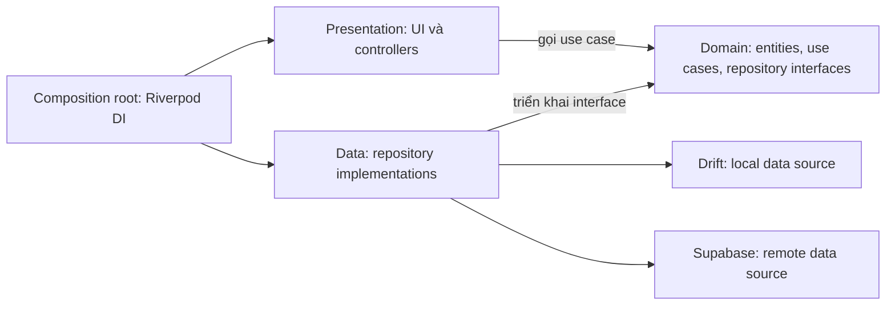
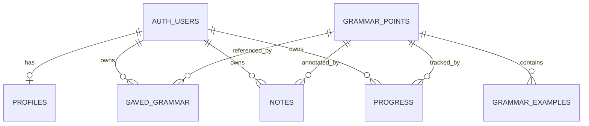

# PRD — Nền kiến trúc và hoàn thiện báo cáo M2 của Bunly

**Dự án:** Bunly — Ứng dụng học và tra cứu ngữ pháp tiếng Nhật từ nội dung thực tế<br>
**Nhóm:** Bunly • **Học kỳ:** Học kỳ 1, năm học 2026–2027<br>
**Mốc đích:** M2 — Detailed Architecture & Core Feature Implementation • **Hạn theo template:** Tuần 8<br>
**Ngày lập:** 22/10/2026<br>
**Trạng thái:** PRD để rà soát trước khi triển khai; chưa phải kết quả nghiệm thu M2.

**Cập nhật triển khai:** Nền Flutter và Supabase đã được tạo trên nhánh `feat/m2-architecture-base`. Hiện trạng ở mục 2 là snapshot lúc lập PRD; xem [kiến trúc hiện có và việc tiếp theo](../development/ARCHITECTURE.md) và [báo cáo xem trước](../reports/Capstone-Report-2-Architecture-Preview.md) để biết tiến độ đã kiểm chứng.

## 1. Mục tiêu và căn cứ

Hoàn thiện báo cáo M2 bằng bằng chứng từ một ứng dụng Flutter có nền kiến trúc ba lớp, dữ liệu Supabase/Drift và luồng chức năng lõi chạy thật. PRD này là cơ sở để nhóm chỉnh thiết kế, chia việc và nghiệm thu trước khi chốt báo cáo.

Ba đầu ra phải đi cùng nhau:

1. **Mã nguồn:** kiến trúc và chức năng lõi có thể chạy, kiểm thử và tái lập.
2. **Báo cáo:** mô tả đúng mã nguồn, có ERD, RLS và kết quả kiểm thử.
3. **Bằng chứng:** commit/tag M2, ảnh giao diện, nhật ký kiểm thử và video 2–3 phút.

| Căn cứ | Áp dụng vào M2 |
|---|---|
| [Báo cáo M1](../reports/Capstone-Report-1-Proposal.md) | Giữ Flutter/Dart 3, Riverpod 2, Drift/SQLite, Supabase và phạm vi sản phẩm đã đề xuất |
| Template Report 2 do người dùng cung cấp | Giữ ba mục chính: Clean Architecture; Database Schema & Security Policies; Core Feature Implementation Progress |
| Week-09-Architecture.pdf, trang 2 và 4 | Ba lớp, Repository Pattern, DI/IoC; domain khai báo interface, data triển khai interface |
| Week-09-Architecture.pdf, trang 6 | Unit, widget và integration/E2E; tỉ lệ 70/20/10 là định hướng phân bổ của tài liệu, không phải chỉ tiêu coverage |

Slide tuần 09 được dùng làm tài liệu thiết kế và kiểm thử. Hạn M2 vẫn là tuần 8 theo template; PRD không tự chuyển thành ngày nộp cụ thể khi chưa có lịch học phần.

## 2. Hiện trạng và kết quả cần đạt

Tại thời điểm lập PRD, checkout có README, báo cáo M1 và prototype HTML. Chưa có dự án Flutter, migration Supabase, schema Drift, bộ kiểm thử, tag hay video M2 được xác minh. Prototype là tài liệu tham khảo giao diện và luồng; dữ liệu mô phỏng trong đó không chứng minh chức năng di động đã hoàn thành.

**Luồng nghiệm thu M2:**

```text
Đăng ký/đăng nhập email → thiết lập hồ sơ → kho ngữ pháp
→ tìm/lọc N5–N4 → chi tiết → lưu mẫu/ghi chú → cập nhật trạng thái học
→ mở lại dữ liệu → đồng bộ cơ bản → kiểm tra bằng tài khoản khác
```

M2 phải chứng minh ứng dụng khởi động lại vẫn giữ dữ liệu đã lưu; nội dung đã tải đọc được khi mất mạng; dữ liệu cá nhân không lẫn giữa tài khoản. Chỉ tiêu 80–120 mẫu của M1 là mục tiêu kho nội dung MVP. Bộ dữ liệu M2 phải có cả N5/N4 và đủ trường để kiểm thử; báo cáo ghi số bản ghi thực tế đã biên tập, không nhận đủ chỉ tiêu khi chưa kiểm tra.

## 3. Phạm vi theo mốc

| Nhóm chức năng MVP đã cam kết | Kết quả M2 | Công việc tiếp nối |
|---|---|---|
| Tài khoản & hồ sơ | Đăng ký/đăng nhập email, đăng xuất, hồ sơ trình độ/mục tiêu/thời gian học | Hoàn thiện trải nghiệm và xử lý lỗi theo kiểm thử |
| Kho ngữ pháp | Danh sách, tìm kiếm, lọc cấp độ/nhóm, chi tiết, đọc nội dung đã tải | Tiếp tục biên tập đủ mục tiêu kho MVP |
| Học tập cá nhân | Lưu/bỏ lưu mẫu, ghi chú, trạng thái học, đồng bộ cơ bản | M3: xung đột nhiều thiết bị, kiểm thử mất mạng mở rộng |
| OCR và phát hiện ngữ pháp | Chốt ranh giới tích hợp và mô hình dữ liệu đầu vào/đầu ra trong thiết kế | M3: ML Kit, Edge Function, LLM, đánh giá AI |
| Luyện tập & ôn tập | Chốt liên hệ với tiến độ; trạng thái M2 lấy từ thao tác người dùng | M3: câu hỏi, kết quả bài làm và lịch ôn tự động |
| Lộ trình & thống kê | Hiển thị số mẫu theo trạng thái học từ dữ liệu thật | Hoàn thiện lộ trình và độ chính xác khi có kết quả bài làm |
| Nhắc nhở | Ghi nhận yêu cầu và vị trí tích hợp cài đặt trong thiết kế | Hoàn thiện trước nghiệm thu MVP cuối kỳ |
| Free/Pro | Ghi nhận hợp đồng kiểm tra hạn mức ở phía máy chủ | M3: tích hợp hạn mức AI; trước mốc cuối: mô phỏng quyền Free/Pro |

Tất cả chín nhóm tính năng trong M1 vẫn là yêu cầu MVP. Chia theo mốc xác định thứ tự thực hiện; không đổi chúng thành tính năng tùy chọn. Thanh toán thật và phát hành thương mại nằm ngoài MVP như M1.

## 4. Yêu cầu chức năng và tiêu chí nghiệm thu

| ID | Yêu cầu M2 | Điều kiện đạt | Bằng chứng |
|---|---|---|---|
| FR-01 | Xác thực email và hồ sơ | Đăng ký/đăng nhập/đăng xuất hoạt động; phản hồi lỗi rõ; khôi phục phiên hợp lệ; lưu được trình độ, mục tiêu và thời gian học | Kiểm thử và video; ghi cách xử lý xác nhận email theo cấu hình thực tế |
| FR-02 | Tra cứu kho ngữ pháp | Tìm theo mẫu/ý nghĩa; kết hợp lọc N5/N4 và nhóm; có trạng thái tải/rỗng/lỗi; chi tiết đủ công thức, cách dùng, ví dụ Nhật–Việt | Dữ liệu seed, ảnh và kiểm thử truy vấn |
| FR-03 | Lưu mẫu và ghi chú | Lưu lặp không tạo bản ghi trùng; sửa/xóa ghi chú đúng mẫu; khởi động lại vẫn giữ dữ liệu; hủy đồng bộ không làm mất thao tác cục bộ | Unit/repository test và luồng thiết bị |
| FR-04 | Trạng thái học và tổng hợp | Bốn trạng thái: mới/đang học/cần ôn/đã nắm; số mẫu tổng hợp khớp dữ liệu của người đang đăng nhập | Test chuyển trạng thái và đối chiếu số liệu |
| FR-05 | Dữ liệu cục bộ và đồng bộ cơ bản | Nội dung đã tải đọc được khi mất mạng; ghi cục bộ và outbox cùng giao dịch; kết nối lại gửi thay đổi của đúng tài khoản; thử lại không tạo trùng | Test khởi động lại, mất/kết nối lại mạng và gửi lặp |
| FR-06 | Cách ly tài khoản | A không đọc/sửa/xóa dữ liệu B, không chèn bản ghi mang chủ sở hữu B; chuyển tài khoản không hiện cache cá nhân của A | Ma trận RLS hai tài khoản và kiểm thử cache |

FR-05 kiểm chứng luồng một người dùng/một thiết bị với retry. Đồng bộ đa thiết bị và giải quyết ghi đồng thời là phần M3; phải ghi rõ giới hạn này trong báo cáo M2.

## 5. Thiết kế nền kiến trúc

### 5.1. Quyết định kỹ thuật

| Thành phần | Hướng triển khai | Cách chốt trước khi viết mã |
|---|---|---|
| Ứng dụng | Flutter stable, Dart 3; Material 3 | Ghi phiên bản SDK đã kiểm tra, pin công cụ và commit lockfile khi khởi tạo |
| Trạng thái và DI | Riverpod 2 theo M1; providers lắp ghép dependency | Kiểm tra tương thích với SDK/Drift/code generation; nếu cần đổi phiên bản lớn, ghi lý do và cập nhật tài liệu |
| Cục bộ | Drift/SQLite | Có schema version, migration, DAO và test giao dịch |
| Từ xa | Supabase Auth và PostgreSQL | Migration, seed và RLS được quản lý trong Git |
| Nền tảng nghiệm thu | Android trên thiết bị/emulator | Ghi model, OS và lệnh chạy; chỉ ghi iOS đã xác minh khi đã build/chạy thực tế |
| Kiểm thử | Flutter test và integration_test | Test domain bằng fake repository; test tích hợp dùng cấu hình kiểm thử riêng |

### 5.2. Chiều phụ thuộc



Domain chỉ dùng Dart thuần; không import Flutter, Riverpod, Supabase hoặc Drift. UI/controller không gọi trực tiếp database/API. Repository điều phối nguồn cục bộ/từ xa, ánh xạ DTO sang entity và chuyển lỗi thành loại lỗi mà use case/UI xử lý được. Riverpod cung cấp implementation cho interface tại composition root; có thể thay bằng fake trong kiểm thử.

### 5.3. Cấu trúc thư mục đích

```text
lib/
  app/                 # khởi động, điều hướng, theme, lắp ghép DI
  core/                # lỗi dùng chung, database và cấu hình client
  features/
    auth/
    grammar/
    learning/          # lưu mẫu, ghi chú và tiến độ
      presentation/    # screens, widgets, controllers
      domain/          # entities, usecases, repository interfaces
      data/            # models, datasources, repository implementations
supabase/
  migrations/
  seed.sql
test/                  # phản chiếu phần mã được kiểm thử
integration_test/
documents/reports/
```

Mỗi feature đã triển khai có ba lớp như ví dụ `learning`. Gộp lưu mẫu/ghi chú/tiến độ trong `learning` ở M2 để giữ quy tắc cập nhật nhất quán; không tạo hàng loạt feature rỗng cho các mốc sau.

**Tính năng mẫu để dựng kiến trúc:** `SaveNote` nhận entity/input → kiểm tra nội dung → gọi `LearningRepository` → implementation ghi Drift và outbox trong transaction → controller cập nhật trạng thái. Bộ đồng bộ đẩy thay đổi qua phiên Supabase của đúng người dùng. Đây là ví dụ xuyên suốt để giải thích kiến trúc và test trong báo cáo.

## 6. Dữ liệu và bảo mật

### 6.1. Schema dự kiến để rà soát

| Bảng | Trường và ràng buộc chính | Mục đích |
|---|---|---|
| `profiles` | `user_id` PK/FK → `auth.users`, `display_name`, `jlpt_level`, `goal`, `daily_minutes`, `updated_at`; kiểm tra cấp độ và thời gian dương | Hồ sơ cá nhân |
| `grammar_points` | `id` UUID PK, `pattern`, `level`, `category`, `meaning_vi`, `formula`, `usage_vi`, `updated_at`; `level` thuộc N5/N4 | Nội dung chung |
| `grammar_examples` | `id` UUID PK, `grammar_id` FK, `sentence_ja`, `translation_vi`, `sort_order` | Ví dụ của mẫu ngữ pháp |
| `saved_grammar` | PK (`user_id`, `grammar_id`), FKs tới tài khoản/mẫu, `created_at`, `updated_at`, `deleted_at` | Lưu/bỏ lưu, giữ dấu xóa phục vụ đồng bộ |
| `notes` | `id` UUID PK sinh ở client, `user_id`, `grammar_id`, `content`, `updated_at`, `deleted_at`; nội dung có giới hạn độ dài | Cho phép nhiều ghi chú trên một mẫu |
| `progress` | PK (`user_id`, `grammar_id`), `status`, `updated_at`; kiểm tra bốn trạng thái | Tiến độ hiện tại; chưa suy ra độ chính xác khi chưa có bài làm |
| `sync_outbox` — chỉ cục bộ | `operation_id` UUID PK, `user_id`, loại bản ghi, khóa bản ghi, thao tác, payload, số lần thử, lỗi và thời điểm tạo | Ghi nhận thao tác chờ gửi cùng transaction với thay đổi cục bộ |

Timestamps phía máy chủ là mốc xác nhận thay đổi từ xa; không dùng đồng hồ client để kết luận thứ tự xung đột giữa thiết bị. Nội dung cục bộ dùng cùng ID với Supabase. Chính sách xóa dây chuyền, giới hạn nội dung và chỉ mục cho các khóa ngoại/truy vấn phải được chốt trong migration.

### 6.2. ERD dự kiến



Sơ đồ này là thiết kế dự kiến. Báo cáo cuối phải bổ sung trường, PK/FK và đối chiếu với migration đã chạy; outbox cục bộ được mô tả riêng vì không phải bảng Supabase.

### 6.3. Chính sách truy cập và đồng bộ

- Bật RLS trên mọi bảng ứng dụng có thể truy cập qua API. Tài khoản đã đăng nhập được đọc kho ngữ pháp/ví dụ; client không được ghi nội dung chung. Seed thực hiện qua công cụ quản trị/migration.
- `profiles` và các bảng cá nhân: SELECT/DELETE kiểm tra `auth.uid() = user_id`; INSERT dùng `WITH CHECK`; UPDATE có cả `USING` và `WITH CHECK` để không đổi chủ sở hữu. Kiểm tra cả quyền bảng và policy.
- App chỉ dùng cấu hình Supabase dành cho client và phiên người dùng. Service-role key và khóa LLM ở phía máy chủ; không đưa vào app, seed, báo cáo hay video.
- Cache/outbox cá nhân phân vùng theo `user_id`. Đăng xuất dừng tác vụ cũ, đóng truy vấn đang theo dõi và ngăn tài khoản mới nhìn dữ liệu cũ. Thao tác chưa gửi của A không được gửi bằng phiên B.
- Đồng bộ M2 gửi tuần tự, dùng ID ổn định và upsert cho trạng thái mong muốn. Retry một thao tác không tạo bản ghi mới; chỉ xác nhận xóa outbox sau khi máy chủ báo thành công. Với thay đổi liên tiếp trên cùng bản ghi, không để phản hồi thao tác cũ ghi đè phiên bản cục bộ mới hơn.
- Xóa ghi chú/bỏ lưu dùng dấu xóa cho luồng M2. Hết phiên đăng nhập hoặc lỗi quyền giữ thao tác ở trạng thái lỗi/chờ, không tự báo đã đồng bộ. M3 bổ sung xử lý xung đột đa thiết bị và vòng đời dấu xóa.

## 7. Kiểm thử và tiêu chuẩn chất lượng

| Cấp kiểm thử | Tình huống bắt buộc M2 | Điều cần chứng minh |
|---|---|---|
| Unit | Validate ghi chú, chuyển trạng thái, tìm/lọc kết hợp, xử lý lỗi repository | Quy tắc nghiệp vụ chạy độc lập SDK/database |
| Repository/Drift | Transaction local + outbox, rollback khi lỗi, retry không trùng, xóa và khởi động lại | Lưu dữ liệu đúng và không mất thao tác |
| Widget | Tải/rỗng/lỗi/thử lại, tìm/lọc, lưu ghi chú thành công/thất bại | Giao diện phản ánh đúng trạng thái |
| RLS tích hợp | A thao tác dữ liệu A; B không đọc/sửa/xóa A; B không chèn/đổi chủ sở hữu thành A; client không ghi kho chung | Cách ly được thực thi ở backend, không chỉ lọc trên UI |
| Thiết bị/E2E | Đăng nhập → tra cứu → ghi chú → mở lại; mất mạng ghi cục bộ → kết nối lại; chuyển tài khoản | Luồng thật hoạt động với SDK, lưu trữ và dịch vụ |

Kết quả từ chối RLS có thể là lỗi quyền hoặc không có hàng trả về/bị tác động; luôn kiểm tra thêm dữ liệu A không thay đổi. Không coi mọi HTTP thành công là policy đã cho phép truy cập.

Các lệnh kiểm tra phải được xác nhận khi xây ứng dụng: format, `flutter analyze`, `flutter test`, lệnh integration test trên thiết bị và build Android. CI chạy phân tích/unit/widget với cấu hình kiểm thử; RLS/E2E cần Supabase kiểm thử và thiết bị tương ứng. Ghi riêng passed, failed, skipped và chưa chạy. Tỉ lệ 70/20/10 từ slide không thay cho kiểm thử tình huống quan trọng.

## 8. Kế hoạch triển khai và thứ tự phụ thuộc

Các chặng dưới đây là thứ tự công việc; chưa gán lịch ngày hoặc người thực hiện khi nhóm chưa thống nhất nguồn lực.

| Chặng | Công việc | Đầu ra và điều kiện chuyển chặng |
|---|---|---|
| P0 — Chốt thiết kế | Rà PRD, schema, ranh giới M2/M3; xác nhận môi trường Flutter/Supabase và thiết bị | Quyết định kỹ thuật, tiêu chí nghiệm thu và nhiệm vụ có người phụ trách |
| P1 — Dựng base | Khởi tạo Flutter, cấu trúc feature, DI, lỗi, theme/điều hướng; dựng `SaveNote` với fake repository | App khởi động; domain test được; không có dependency ngược |
| P2 — Dữ liệu | Viết migration, seed, RLS, Drift và outbox; kiểm thử hai tài khoản | Dựng lại được DB kiểm thử; policy và transaction đạt |
| P3 — Luồng lõi | Ghép auth/hồ sơ, kho ngữ pháp, chi tiết, ghi chú và tiến độ với dữ liệu thật | FR-01 đến FR-04 chạy trên Android; bộ lọc/trạng thái lỗi có kiểm thử |
| P4 — Độ tin cậy | Đồng bộ cơ bản, retry, khởi động lại, đổi tài khoản và đọc offline | FR-05/FR-06 đạt; ghi rõ giới hạn đa thiết bị |
| P5 — Hoàn thiện báo cáo | Cập nhật kiến trúc/ERD từ mã, ghi kết quả test, quay demo, chốt commit/tag | Báo cáo đúng template; bằng chứng khớp commit; video 2–3 phút |

Có thể chia công việc nhóm thành ba tuyến: nền Flutter/tích hợp, dữ liệu/bảo mật và giao diện/nội dung. Chỉ triển khai song song sau khi thống nhất interface, schema và tiêu chí lỗi; chưa gán tên thành viên thay cho quyết định của nhóm.

**Phụ thuộc cần có khi triển khai:** SDK Flutter và Android tương thích; thiết bị/emulator; Supabase dành cho phát triển/kiểm thử; cấu hình URL/client key; hai tài khoản kiểm thử kiểm soát được xác nhận email; dữ liệu ngữ pháp đã biên tập. Thiếu Supabase vẫn có thể dựng domain/UI bằng fake, nhưng chưa đạt nghiệm thu tích hợp/RLS. Chưa cần khóa LLM cho phạm vi M2 này.

## 9. Cấu trúc báo cáo và bằng chứng bàn giao

Mở [bản xem trước báo cáo M2](../reports/Capstone-Report-2-Architecture-Preview.md) để rà nội dung theo đúng ba mục template. Bản xem trước chỉ chứa mục tiêu và vị trí bằng chứng; chuyển sang báo cáo nộp sau khi có kết quả thật.

| Mục báo cáo | Nội dung cần chốt | Nguồn bằng chứng |
|---|---|---|
| 1. Clean Architecture Implementation | Cây thư mục thật, chiều phụ thuộc, use case `SaveNote`, DI và trách nhiệm repository | Mã ở commit M2 và test liên quan |
| 2. Database Schema & Security Policies | ERD có trường/PK/FK, SQL migration/policy, phân biệt local/remote, kết quả RLS | Migration và log từ môi trường kiểm thử |
| 3. Core Feature Implementation Progress | Bảng trạng thái từng FR, kết quả kiểm thử, giới hạn, tag/commit và video | Ảnh, log, thiết bị/OS, URL tag và video thực tế |

**Kịch bản video dự kiến — 2 phút 45 giây:** 0:00–0:20 giới thiệu commit/phạm vi; 0:20–0:45 đăng nhập và hồ sơ; 0:45–1:15 tìm/lọc và chi tiết; 1:15–1:50 lưu ghi chú/trạng thái rồi mở lại; 1:50–2:20 đọc offline và đồng bộ sau kết nối lại; 2:20–2:45 trình bày kết quả cách ly tài khoản và giới hạn. Che thông tin tài khoản, mã xác thực và cấu hình nhạy cảm.

## 10. Điều kiện hoàn thành và điểm cần rà soát

M2 được coi là hoàn thành khi FR-01 đến FR-06 có kết quả đạt; app build/chạy trên nền tảng đã ghi nhận; kiến trúc, migration và kiểm thử tái lập được; báo cáo hết chỗ trống bằng chứng; tag/commit và video trỏ đúng bản trình diễn. Xem trước báo cáo hoặc tạo tag riêng lẻ chưa đủ điều kiện hoàn thành.

| Điểm nhóm cần rà | Mặc định trong PRD | Khi thay đổi cần sửa |
|---|---|---|
| Phạm vi ghi chú | Nhiều ghi chú trên một mẫu | Schema, use case, UI và test liên quan |
| Nội dung chung | Người đã đăng nhập đọc; client không ghi | Quyền bảng, RLS và luồng trước đăng nhập |
| Tiến độ M2 | Người dùng đổi trạng thái; thống kê đếm từ dữ liệu thật | Bổ sung quy tắc bài làm nếu triển khai sớm luyện tập |
| Đồng bộ | Một thiết bị, retry tuần tự và dấu xóa | Hợp đồng version/xung đột nếu mở rộng nhiều thiết bị |
| Nền tảng demo | Android | Môi trường build/test và bằng chứng nếu chọn thêm iOS |
| SDK/package | Giữ định hướng M1; chốt phiên bản qua kiểm tra tương thích | Ghi quyết định và đồng bộ tài liệu trước triển khai |

Sau mỗi thay đổi thiết kế, cập nhật PRD, preview báo cáo và tiêu chí kiểm thử liên quan trước khi chốt mã. Mọi chức năng chưa có bằng chứng tiếp tục được ghi là chưa triển khai/chưa xác minh trong báo cáo tiến độ.
