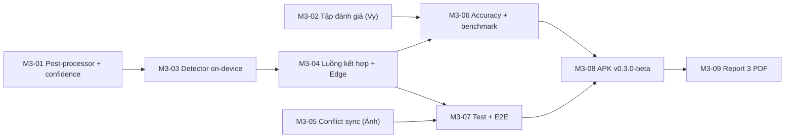

# PRD M3 — Hoàn thiện AI on-device, Offline Sync & Kiểm thử cho Report 3

Ngày lập: **10/11/2026** · Nhánh nền: `dev` (`d24e936`) · Trạng thái tài liệu: **Kế hoạch (Todo)**, chưa phải biên bản nghiệm thu.

Tài liệu này bổ sung cho [PRD tổng thể](PRD-BUNLY-Full-Function-Baseline.md) và [phân công baseline](BASELINE-DELIVERY-OWNERSHIP.md). Nó chỉ chốt phạm vi cần làm để nộp **Report 3: Tích hợp AI (ML Kit/Core ML/TFLite/LLM), Offline Sync & Automated Tests [M3 – 15%]**. Template nộp bài: [`templates/Capstone-Report-3-AI-Testing.md`](../reports/templates/Capstone-Report-3-AI-Testing.md).

---

## 1. Vì sao cần PRD này

### 1.1. Yêu cầu môn học cho Report 3

Theo [knowledge pack](../../CROSS_PLATFORM_CAPSTONE_KNOWLEDGE_PACK.md) (Week 11, tr. 55 và mục D, C, F), Report 3 phải chứng minh 5 điểm:

1. **On-device AI chạy được** trên điện thoại, kể cả khi offline (không chỉ gọi cloud LLM).
2. **Heuristic post-processing**: biến kết quả AI thô thành dữ liệu có cấu trúc bằng rules/regex/validation.
3. **Human review có thể sửa + confidence indicator** trước khi lưu.
4. **Offline persistence + sync queue**, có **quy tắc xử lý xung đột** khi 2 thiết bị sửa cùng bản ghi.
5. **Latency benchmark** đo thật trên thiết bị (số mẫu, p50/p95, đơn vị ms, điều kiện đo), cùng bộ test tự động.

### 1.2. Hiện trạng thật của Bunly (đã đọc code ngày 10/11/2026)

| Yêu cầu | Đã có | Khoảng trống |
|---|---|---|
| On-device AI | ML Kit Text Recognition v2 (Japanese) trong [`mlkit_ocr_repository.dart`](../../lib/features/ocr/data/mlkit_ocr_repository.dart), chạy offline | Chỉ có OCR. Khi offline, phần "nhận diện ngữ pháp" chỉ so trùng **nguyên câu** với ví dụ trong kho ([`catalog_sentence_preview.dart`](../../lib/features/analysis/data/catalog_sentence_preview.dart)), gần như không dùng được với câu thật |
| Post-processing | [`normalizeOcrText`](../../lib/features/ocr/domain/ocr_draft.dart) chỉ đổi xuống dòng và `trim()` | Chưa xử lý khoảng trắng thừa giữa chữ Nhật, ký tự nửa/toàn độ rộng, dòng bị cắt, ký tự rác |
| Human review | Màn `Xác nhận câu tiếng Nhật` cho sửa văn bản trước khi gửi AI | **Chưa có confidence indicator**. Plugin đang dùng (`google_mlkit_text_recognition` 0.17.1) có `TextLine.confidence` / `TextElement.confidence` (kiểu `double?`, có thể null) nhưng app chưa đọc |
| LLM | Edge Function `analyze-grammar` gọi `gemini-3.5-flash-lite`, kiểm tra ID theo kho 90 UUID và span UTF-16, quota + idempotency. Đã test live trên Cloud | Gửi **toàn bộ 90 ứng viên** mỗi lần (~5.573 prompt tokens). Chưa có số đo độ chính xác trên tập câu kiểm thử |
| Offline sync | Drift v3 + `sync_outbox`, push/pull theo user, practice attempts idempotent, `SyncBanner` | [`learning_sync.dart`](../../lib/features/learning/data/learning_sync.dart) vẫn `upsert` thẳng. RPC `bunly_sync_personal_record` và cột `conflictPayload` đã có nhưng **chưa dùng**. Chưa có quy tắc conflict được công bố |
| Test | 87 Flutter tests, 104 pgTAP, 29 Edge unit, 1 Edge integration, 3 connected tests, CI | Chưa đo **coverage**, chưa có **benchmark latency/RAM/FPS**, chưa có E2E airplane-mode trên máy thật |
| APK nội bộ | APK Connected Cloud chạy trên Samsung A11; tag `v0.1.0-cloud.1` | Release trên GitHub mới chỉ có `demo-offline.apk` (CI chưa đọc được 2 secret Cloud) |

**Kết luận:** Đúng là AI hiện tại mới chỉ là **OCR ML Kit + gọi Gemini API**. Để Report 3 có giá trị và khớp rubric, M3 cần bổ sung **một lớp AI on-device thật sự có ích cho người học** (nhận diện ngữ pháp offline bằng rules + confidence), cùng với **số đo thật**, thay vì chỉ thêm tính năng gọi cloud.

---

## 2. Mục tiêu và ngoài phạm vi

### 2.1. Mục tiêu M3

- **G1.** Khi **không có mạng**, người dùng vẫn chụp ảnh → OCR → hậu xử lý → **nhận gợi ý mẫu ngữ pháp trên máy** kèm vị trí trong câu và mức tin cậy → sửa/xác nhận → lưu.
- **G2.** Khi có mạng, Gemini vẫn là bước phân tích chính, nhưng được **lọc ứng viên trước bằng bộ nhận diện on-device** để giảm token và độ trễ (có số đo trước/sau).
- **G3.** Đồng bộ đa thiết bị có **quy tắc xung đột rõ ràng**, có test và demo airplane mode đủ 8 case của môn học.
- **G4.** Có **bảng benchmark thật** (OCR, nhận diện on-device, Gemini, cold start, RAM, APK size, FPS) và **độ chính xác** trên tập câu kiểm thử riêng.
- **G5.** Hoàn thành **Report 3** (PDF) và **link APK kiểm thử nội bộ** trên GitHub Releases.

### 2.2. Ngoài phạm vi M3 (để M4)

Nhắc học local notification (B-FR-10), keystore release ký chính thức, nối AI cho `Dịch Việt → Nhật` / `Nói một câu`, iOS, duyệt toàn bộ 90 mẫu/180 câu (chỉ cần duyệt phần dùng cho tập đánh giá), Report 4/slide/video cuối. **Không** train/fine-tune model, **không** thêm TFLite custom khi chưa có dữ liệu gán nhãn.

---

## 3. Yêu cầu chức năng

### M3-FR-01 — Hậu xử lý OCR tiếng Nhật (heuristic post-processing)
- Thay `normalizeOcrText` bằng một pipeline thuần Dart trong `features/ocr/domain/` (ví dụ `JapaneseOcrPostProcessor`), gồm:
  - Bỏ khoảng trắng chen giữa 2 ký tự CJK/Kana (ML Kit hay chèn); giữ khoảng trắng giữa chữ Latin.
  - Chuẩn hóa NFKC có kiểm soát: chữ số/Latin toàn độ rộng → nửa độ rộng; **giữ nguyên** Kana/Kanji và dấu câu Nhật `。、「」`.
  - Nối dòng bị cắt giữa câu (dòng không kết thúc bằng `。！？`), tách câu theo `。！？`.
  - Lọc dòng rác (tỉ lệ ký tự Nhật quá thấp, chỉ có ký hiệu).
- Trả thêm **danh sách câu** để người dùng chọn câu muốn phân tích khi ảnh có nhiều câu.
- **Chấp nhận:** Unit test cho từng rule (input rỗng, chỉ rác, nhiều câu, có Latin/số, có furigana bị tách dòng). Không làm mất Kanji/Kana so với input.

### M3-FR-02 — Confidence indicator cho OCR
- Đọc `TextLine.confidence` từ ML Kit (nullable). Lưu vào `OcrBlock`/`OcrLine` (domain không phụ thuộc plugin).
- UI màn `Xác nhận câu tiếng Nhật`: hiển thị nhãn **Rõ / Cần kiểm tra / Thấp** theo ngưỡng (ngưỡng ban đầu đề xuất 0.8 / 0.5, chốt sau khi đo), **tô vàng các dòng có confidence thấp** để người dùng sửa.
- Nếu thiết bị trả `null` → hiển thị "Không có điểm tin cậy từ thiết bị", **không** tự tính ra con số giả.
- **Chấp nhận:** Widget test cho 3 mức + trường hợp null. Báo cáo ghi rõ confidence là của ML Kit, không phải độ chính xác.

### M3-FR-03 — Nhận diện ngữ pháp on-device (offline) bằng luật
- Tạo `OnDeviceGrammarDetector` trong `features/analysis/` (domain interface + data implementation), chạy **hoàn toàn trên máy**:
  - Mỗi mẫu trong kho có **bộ luật nhận diện** (regex/chuỗi bề mặt + điều kiện chia động từ đơn giản), ví dụ `〜たことがある` khớp `(た|だ)ことが(ある|あります|あった)`.
  - Luật lưu dạng dữ liệu (ví dụ trường `detection_rules` trong `grammar.json` hoặc file `assets/data/grammar_rules.json`), **không** hard-code trong widget.
  - Đầu ra: danh sách `{grammarId, span UTF-16, ruleId, score}`; `score` là điểm heuristic (độ dài khớp, độ đặc hiệu của luật), **gắn nhãn "ước lượng theo luật"**.
  - Xử lý trùng lặp/chồng span (ưu tiên mẫu dài hơn, ví dụ `〜てもいい` thắng `〜ても`).
- Phạm vi luật: **tối thiểu 40/90 mẫu** có luật ở M3 (ưu tiên mẫu có trong tập đánh giá), số còn lại ghi rõ "chưa có luật on-device".
- **Chấp nhận:** Unit test cho từng luật (khớp đúng, không khớp nhầm câu gần giống). Chạy được khi bật chế độ Máy bay.

### M3-FR-04 — Luồng phân tích kết hợp: on-device trước, Gemini sau
- Màn `Xác nhận câu tiếng Nhật`:
  - **Offline hoặc hết quota:** nút chính là **"Gợi ý ngữ pháp trên máy"** → mở `SentenceResultScreen` với badge **"Gợi ý trên máy · Chưa qua AI cloud"** và mức tin cậy.
  - **Online:** vẫn có nút **"Phân tích ngữ pháp AI"**. Client gửi kèm **danh sách ứng viên on-device** (tối đa N) cho Edge Function.
- Edge Function `analyze-grammar`: nhận `candidate_ids` tùy chọn, **chỉ chấp nhận ID nằm trong allowlist**; nếu ít/không có ứng viên thì quay về toàn bộ allowlist (không giảm recall). Giữ nguyên quota/idempotency.
- Người dùng xác nhận/bỏ từng gợi ý trước khi lưu ghi chú (human-in-the-loop).
- **Chấp nhận:** Test Edge Function cho `candidate_ids` hợp lệ/không hợp lệ/rỗng. So sánh prompt tokens và latency trước/sau trên cùng tập câu.

### M3-FR-05 — Quy tắc xung đột đồng bộ đa thiết bị
- Công bố quy tắc (ghi trong Report 3 và `ARCHITECTURE.md`):
  - **Ghi chú (`notes`):** Manual conflict. Dùng RPC `bunly_sync_personal_record` với `base_revision`; khi server trả `conflict`, lưu bản server vào `conflictPayload` và hiện hộp thoại **Giữ bản trên máy / Dùng bản trên máy chủ**.
  - **Hồ sơ, mẫu đã lưu, trạng thái học:** Last-Write-Wins theo **revision của server** (không tin đồng hồ máy).
  - **Bài làm (`practice_attempts`):** Append-only, idempotent theo `id` (đã có).
  - **Xóa:** tombstone `deleted_at`, không xóa cứng.
- Sửa `SupabaseLearningRemote`/`LearningSync` gọi RPC thay vì `upsert`; outbox không bị mất khi lỗi HTTP/server.
- **Chấp nhận:** Test repository (fake remote) cho: thành công, conflict, lỗi mạng giữ outbox, retry không trùng. Connected test 2 user/2 phiên sửa cùng ghi chú.

### M3-FR-06 — Trạng thái đồng bộ rõ ràng
- `SyncBanner`/Hồ sơ hiển thị đủ trạng thái `Chờ mạng (n) / Đang đồng bộ / Đã đồng bộ / Lỗi – Thử lại / Có xung đột (n)`.
- **Chấp nhận:** Widget test cho 5 trạng thái.

---

## 4. Yêu cầu đo lường, đánh giá và kiểm thử

### M3-EV-01 — Tập câu đánh giá AI (Vy chủ trì)
- **50 câu tiếng Nhật N5/N4** có đáp án là danh sách `grammar_id` đúng, **tách hoàn toàn** khỏi ví dụ trong `grammar.json` và câu luyện tập (tránh "học thuộc đề").
- Thêm **15 ảnh thật** (sách, bảng, màn hình) kèm văn bản chuẩn để đo OCR.
- Lưu tại `documents/development/fixtures/eval/` (JSON + ảnh), có ghi nguồn câu/ảnh.

### M3-EV-02 — Chỉ số độ chính xác
| Thành phần | Chỉ số | Cách đo |
|---|---|---|
| OCR ML Kit | Character Error Rate (CER) trước và sau hậu xử lý | 15 ảnh thật, so với văn bản chuẩn |
| On-device detector | Precision, Recall, F1 theo `grammar_id` | 50 câu, script Dart/Node chạy offline |
| Gemini (`analyze-grammar`) | Precision, Recall, F1; tỉ lệ `invalid_output` | 50 câu gọi Cloud `bunly-dev` (cần tạm nâng quota tài khoản test — thao tác hosted phải được Hoàng xác nhận) |
| Kết hợp (on-device lọc + Gemini) | Như trên + prompt tokens trung bình | 50 câu |

### M3-EV-03 — Benchmark hiệu năng trên thiết bị thật
- Đo trên **Samsung Galaxy A11 (SM-A115F)** bằng bản **release/profile**, ghi model máy, Android version, SHA commit, chế độ mạng.
| Hạng mục | Cách đo | Báo cáo |
|---|---|---|
| OCR latency | `Stopwatch` quanh `processImage`, 15 ảnh × 3 lần | n, p50, p95 (ms) |
| On-device detector latency | 50 câu × 10 lần | n, p50, p95 (ms) |
| Gemini end-to-end latency | 50 câu, từ bấm nút đến có kết quả | n, p50, p95 (ms), mạng Wi-Fi/4G |
| Cold start | `adb shell am start -S -W` × 5 | TotalTime p50 (ms) |
| RAM | `adb shell dumpsys meminfo app.bunly.bunly` trước/sau OCR | PSS (MB), chênh lệch |
| FPS / jank | Flutter DevTools hoặc `flutter run --profile` khi cuộn Tra cứu, mở kết quả | % frame > 16ms; **chỉ ghi 60fps nếu đo được** |
| APK size | Kích thước file release | MB |
- Benchmark có thể chạy bằng `integration_test` riêng (ví dụ `integration_test/m3_benchmark_test.dart`) để tái lập.

### M3-TS-01 — Bộ test tự động bổ sung
- Unit: post-processor, confidence mapping, từng luật detector, xử lý chồng span, conflict resolver.
- Repository: sync thành công/conflict/lỗi mạng/retry (fake remote).
- Widget: confidence indicator, kết quả on-device, hộp thoại conflict, 5 trạng thái sync.
- Edge Function: `candidate_ids`.
- E2E trên máy thật: OCR offline → gợi ý on-device → lưu ghi chú offline → restart → bật mạng → sync → đăng nhập máy thứ 2 thấy dữ liệu.
- **Coverage:** chạy `flutter test --coverage`, báo cáo **con số thật** (template gợi ý ≥ 80%; nếu chưa đạt thì ghi đúng số và phần chưa phủ).

### M3-TS-02 — Kịch bản demo airplane mode (8 case môn học)
1. Có mạng tạo ghi chú. 2. Bật Máy bay, thêm/sửa ghi chú + làm quiz. 3. Tắt hẳn app, mở lại vẫn còn. 4. Bật mạng, đồng bộ. 5. Không trùng bản ghi. 6. Đăng nhập máy khác thấy dữ liệu. 7. Hai máy sửa cùng ghi chú → hộp thoại conflict. 8. Lỗi server không làm mất outbox.

---

## 5. Phân công và thứ tự thực hiện

| ID | Việc | Thực hiện | Review | Phụ thuộc |
|---|---|---|---|---|
| M3-01 | Post-processor + confidence (FR-01, FR-02) | Hoàng + agent | Ánh code, Vy chữ/nhãn | — |
| M3-02 | Soạn tập đánh giá 50 câu + 15 ảnh (EV-01) | **Vy** | Ánh định dạng dữ liệu | — (làm song song ngay) |
| M3-03 | Luật nhận diện ≥ 40 mẫu + detector (FR-03) | Hoàng + agent soạn luật | **Vy duyệt luật/ngữ nghĩa**, Ánh code | M3-01 |
| M3-04 | Luồng kết hợp + `candidate_ids` Edge Function (FR-04) | Hoàng | Ánh auth/validation | M3-03 |
| M3-05 | Conflict sync + trạng thái sync (FR-05, FR-06) | **Ánh** | Hoàng tích hợp, Vy test 2 máy | — (làm song song) |
| M3-06 | Script đánh giá accuracy + benchmark (EV-02, EV-03) | Hoàng | Ánh phương pháp đo | M3-02, M3-04 |
| M3-07 | Test bổ sung + coverage + E2E (TS-01, TS-02) | Hoàng + Ánh | Vy chạy UAT | M3-01…05 |
| M3-08 | Sửa secret CI, phát hành APK kiểm thử nội bộ (`v0.3.0-beta`) | Hoàng | Ánh | M3-07 |
| M3-09 | Viết Report 3 + xuất PDF lên Drive | Ánh kỹ thuật (mục 2–3), Hoàng (mục 1, số đo), Vy rà nội dung/hình | Cả nhóm | M3-06…08 |

Hạn chót Report 3 theo template là **Week 11**. Nhóm cần điền ngày cụ thể vào đây khi chốt: `Hạn nộp: ____/11/2026`.

---

## 6. Định nghĩa hoàn thành (Definition of Done) cho Report 3

- [ ] Video ngắn hoặc ảnh chụp chứng minh **OCR + gợi ý ngữ pháp on-device chạy khi bật Máy bay** trên Samsung A11.
- [ ] Màn xác nhận có **confidence indicator** và cho sửa trước khi lưu.
- [ ] Quy tắc xung đột được công bố, có test và demo đủ 8 case airplane mode.
- [ ] Bảng **benchmark thật** (n, p50, p95, ms, thiết bị, SHA) và **bảng độ chính xác** (precision/recall/F1, CER) trên tập đánh giá riêng.
- [ ] `dart format`, `flutter analyze`, `flutter test --coverage`, pgTAP, Edge tests đều xanh; coverage ghi số thật.
- [ ] GitHub Release `v0.3.0-beta` có APK Connected Cloud + SHA-256.
- [ ] Report 3 viết theo template, xuất PDF lên thư mục Drive công khai; phần chưa làm/chưa đo ghi rõ là **chưa xác minh**.

## 7. Rủi ro và cách xử lý

| Rủi ro | Cách xử lý |
|---|---|
| `confidence` của ML Kit trả `null` trên thiết bị | Hiển thị trạng thái "không có điểm tin cậy", vẫn tô dòng nghi ngờ bằng heuristic tỉ lệ ký tự Nhật và ghi rõ đây là ước lượng |
| Luật on-device bắt nhầm mẫu gần giống | Test âm tính cho từng luật, ưu tiên span dài, Vy duyệt luật; báo cáo precision thật |
| Hết quota Gemini Free Tier khi chạy đánh giá | Chạy theo lô nhỏ, tạm nâng quota tài khoản test có xác nhận, lưu kết quả để không phải gọi lại |
| Không đủ 2 máy Android để test conflict | Dùng 1 máy thật + 1 emulator, hoặc 2 phiên connected test; ghi rõ điều kiện |
| Không đạt coverage 80% | Ưu tiên phủ domain/data; ghi đúng con số, không làm tròn lên |
