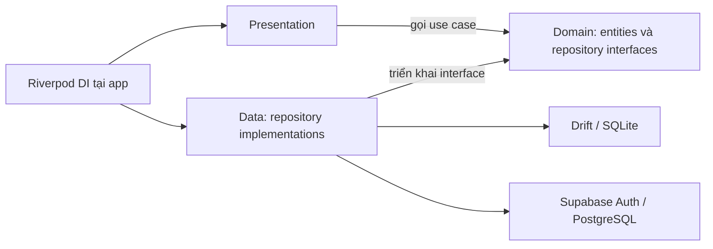
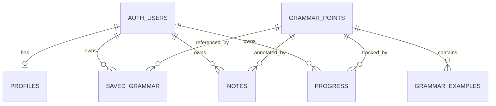

# [REPORT 2 — BẢN XEM TRƯỚC] DETAILED ARCHITECTURE & CORE FEATURE IMPLEMENTATION

**Học phần:** Phát triển ứng dụng di động đa nền tảng (9) 
**Giảng viên:** TS. Nguyễn Thanh Tuấn 
**Tên đề tài:** Bunly — Ứng dụng học và tra cứu ngữ pháp tiếng Nhật từ nội dung thực tế 
**Nhóm:** Bunly • **Học kỳ:** Học kỳ 1, năm học 2026–2027 • **Hạn theo template:** Tuần 8

> Đây là khung báo cáo để rà soát trước khi xây nền kiến trúc. Tại thời điểm lập, repository chưa có mã Flutter hoặc kết quả kiểm thử M2. Các thiết kế dưới đây là mục tiêu triển khai; không phải tuyên bố đã hoàn thành. Kế hoạch và tiêu chí nghiệm thu nằm trong [PRD M2](../planning/PRD-M2-Architecture-Base.md).

## 1. CLEAN ARCHITECTURE IMPLEMENTATION

### 1.1. Luồng chức năng mục tiêu

Đăng ký/đăng nhập email → thiết lập hồ sơ → tìm/lọc mẫu ngữ pháp → xem chi tiết → lưu mẫu/ghi chú → cập nhật và xem lại tiến độ.

### 1.2. Ba lớp kiến trúc

| Lớp | Thiết kế cho Bunly | Bằng chứng cần bổ sung khi triển khai |
|---|---|---|
| Presentation | Màn hình, widget, Riverpod controllers; trạng thái tải/rỗng/lỗi/thành công | Đường dẫn file thật, ảnh giao diện, widget test |
| Domain | Entity, use case, repository interface bằng Dart thuần | Entity/use case thật và unit test |
| Data | Repository implementation, Supabase remote source, Drift local source, ánh xạ model | Đường dẫn implementation và test nguồn dữ liệu |

Sơ đồ dự kiến tuân theo chiều phụ thuộc ở trang 4 của slide Week 09. Domain độc lập Flutter/SDK dữ liệu. UI không gọi trực tiếp Supabase/Drift; Riverpod lắp ghép dependency tại lớp khởi tạo ứng dụng.

### 1.3. Ví dụ xuyên suốt: lưu ghi chú

Thiết kế: controller gọi `SaveNote` → use case kiểm tra dữ liệu và gọi interface `LearningRepository` → implementation lưu ghi chú cùng thao tác outbox trong transaction Drift → bộ đồng bộ gửi dữ liệu qua phiên Supabase của người dùng.

**Cần bổ sung trước khi nộp:** cây thư mục thực tế; trích đoạn use case/interface/implementation/DI cùng đường dẫn file và commit; cách xử lý lỗi; kết quả unit và repository test. Chỉ mô tả thành phần thực sự có trong mã.

## 2. DATABASE SCHEMA & SECURITY POLICIES

### 2.1. Thiết kế ERD dự kiến

| Nhóm dữ liệu | Thiết kế dự kiến |
|---|---|
| Nội dung chung | `grammar_points`: mẫu, cấp độ, nhóm, ý nghĩa, công thức, cách dùng; `grammar_examples`: câu Nhật và bản dịch Việt |
| Cá nhân | `profiles`, `saved_grammar`, `notes`, `progress`; chủ sở hữu gắn với `auth.users` qua `user_id` |
| Cục bộ | Drift lưu nội dung đã tải và dữ liệu cá nhân; `sync_outbox` giữ thay đổi chờ gửi, phân vùng theo tài khoản |

**Cần bổ sung trước khi nộp:** ERD có tên trường, kiểu dữ liệu, PK/FK và ràng buộc khớp migration; đường dẫn migration/seed; số mẫu N5/N4 thực tế; schema version Drift. Không đưa outbox cục bộ thành bảng Supabase nếu chưa có thiết kế đó.

### 2.2. Chính sách RLS mục tiêu

Kho ngữ pháp/ví dụ cho tài khoản đã đăng nhập đọc; client không ghi. Dữ liệu cá nhân giới hạn bằng `auth.uid() = user_id`: SELECT/DELETE dùng `USING`, INSERT dùng `WITH CHECK`, UPDATE dùng cả hai. App không chứa service-role key.

| Tình huống kiểm tra | Kết quả mong đợi | Kết quả thực tế |
|---|---|---|
| A đọc/sửa dữ liệu của A | Thành công | Chưa chạy |
| B đọc dữ liệu của A | Không có dữ liệu A trả về | Chưa chạy |
| B sửa/xóa dữ liệu của A | Dữ liệu A không thay đổi | Chưa chạy |
| B chèn hoặc đổi `user_id` thành A | Bị từ chối | Chưa chạy |
| Client ghi kho ngữ pháp chung | Bị từ chối | Chưa chạy |
| A đăng xuất, B đăng nhập | B không thấy cache A; outbox A không gửi bằng phiên B | Chưa chạy |

**Cần bổ sung trước khi nộp:** SQL policy thực tế; môi trường và thời điểm chạy; log đã ẩn thông tin nhạy cảm; kiểm tra dữ liệu trước/sau thao tác. Bộ lọc `user_id` ở UI không thay thế RLS.

## 3. CORE FEATURE IMPLEMENTATION PROGRESS

### 3.1. Trạng thái triển khai tại thời điểm lập bản xem trước

| Yêu cầu | Đầu ra M2 cần đạt | Trạng thái xác minh |
|---|---|---|
| FR-01 | Xác thực email, phiên đăng nhập và hồ sơ | Chưa triển khai trong checkout |
| FR-02 | Kho ngữ pháp, tìm/lọc, chi tiết | Chỉ có prototype mô phỏng; chưa có Flutter |
| FR-03 | Lưu mẫu, ghi chú và mở lại | Chỉ có phản hồi mô phỏng; chưa có lưu trữ thật |
| FR-04 | Trạng thái học và thống kê từ dữ liệu | Prototype dùng số liệu minh họa |
| FR-05 | Đọc offline, ghi cục bộ và đồng bộ cơ bản | Chưa triển khai |
| FR-06 | RLS và cách ly cache/tài khoản | Chưa triển khai/kiểm thử |

OCR, LLM, luyện tập/lịch ôn, đồng bộ đa thiết bị và hạn mức AI tiếp tục theo kế hoạch M3. Nhắc nhở và mô hình Free/Pro phải hoàn thiện trước nghiệm thu MVP cuối kỳ. Các chức năng này vẫn thuộc phạm vi MVP đã cam kết ở M1.

### 3.2. Kết quả kiểm thử cần ghi nhận

| Nhóm | Bằng chứng cần điền | Trạng thái hiện tại |
|---|---|---|
| Unit/repository | Lệnh, số test pass/fail/skip, log use case và lưu trữ | Chưa chạy |
| Widget | Lệnh và kết quả tương tác/tải/rỗng/lỗi | Chưa chạy |
| RLS | Kết quả ma trận hai tài khoản ở mục 2.2 | Chưa chạy |
| Integration/E2E | Thiết bị/OS, luồng lõi, mất/kết nối lại mạng, đổi tài khoản | Chưa chạy |
| Phân tích và build | Phiên bản SDK, kết quả analyze/build Android | Chưa chạy |

Trang 6 của slide Week 09 gợi ý unit/widget/E2E theo tỉ lệ 70/20/10. Báo cáo phải ghi kết quả thực tế; không tự nhận đạt tỉ lệ hoặc coverage khi chưa đo.

### 3.3. Mã nguồn và video M2

- **GitHub Tag / Branch M2:** Chưa tạo và chưa có URL được xác minh. Sau nghiệm thu, bổ sung liên kết `milestone-2` và SHA commit đầy đủ.
- **Video demo M2 — 2–3 phút:** Chưa quay và chưa có URL. Video phải khớp commit M2, thể hiện đăng nhập → tra cứu → ghi chú/tiến độ → lưu lại/đọc offline và bằng chứng cách ly tài khoản.
- **Giới hạn phải ghi:** nền tảng đã thử, số mẫu đã biên tập, lỗi còn tồn tại và phạm vi đồng bộ đã kiểm chứng. Độ chính xác học tập chỉ được báo cáo khi có dữ liệu bài làm thật.

Trước khi nộp, đổi trạng thái bản xem trước thành báo cáo chính thức sau khi điền đủ bằng chứng và đối chiếu với PRD. Giữ kết quả chưa đạt/chưa chạy đúng thực tế thay vì thay bằng mô tả mục tiêu.
