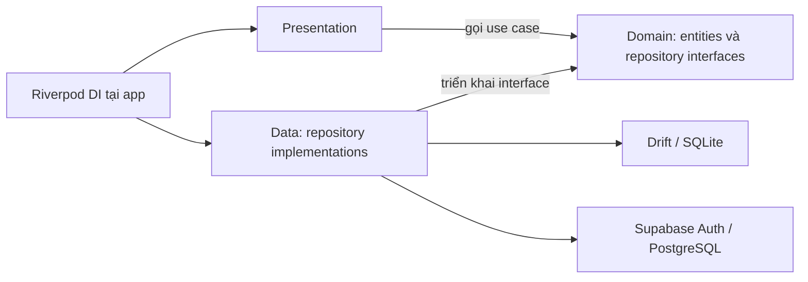
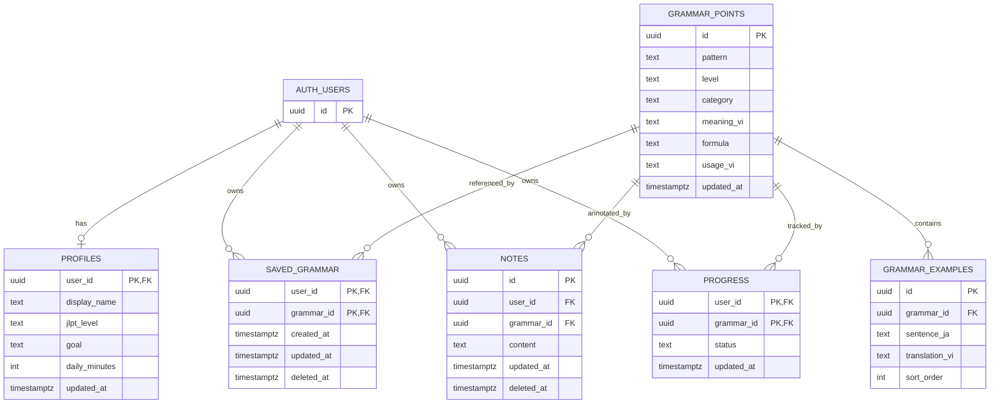

# [REPORT 2 — BẢN XEM TRƯỚC] DETAILED ARCHITECTURE & CORE FEATURE IMPLEMENTATION

**Học phần:** Phát triển ứng dụng di động đa nền tảng (9) 
**Giảng viên:** TS. Nguyễn Thanh Tuấn 
**Tên đề tài:** Bunly — Ứng dụng học và tra cứu ngữ pháp tiếng Nhật từ nội dung thực tế 
**Nhóm:** Bunly • **Học kỳ:** Học kỳ 1, năm học 2026–2027 • **Hạn theo template:** Tuần 8

> Bản xem trước được cập nhật theo base trên nhánh `feat/m2-architecture-base` ngày 22/10/2026. Đã có Flutter, schema, kiểm thử và CI; chưa đạt nghiệm thu toàn bộ M2. Kế hoạch nằm trong [PRD M2](../planning/PRD-M2-Architecture-Base.md); hướng phát triển và giới hạn đã kiểm chứng nằm trong [tài liệu kiến trúc](../development/ARCHITECTURE.md).

## 1. CLEAN ARCHITECTURE IMPLEMENTATION

### 1.1. Luồng chức năng mục tiêu

Đăng ký/đăng nhập email → thiết lập hồ sơ → tìm/lọc mẫu ngữ pháp → xem chi tiết → lưu mẫu/ghi chú → cập nhật và xem lại tiến độ.

### 1.2. Ba lớp kiến trúc

| Lớp | Phần đã xây trong base | Bằng chứng trong repository |
|---|---|---|
| Presentation | Form Auth, kho/chi tiết ngữ pháp, ghi chú và Riverpod controllers | `lib/features/*/presentation/`; `test/presentation/app_test.dart` |
| Domain | Entity, `Authenticate`, `SearchGrammar`, `SaveNote`, repository interfaces bằng Dart thuần | `lib/features/*/domain/`; `test/domain/use_cases_test.dart` |
| Data | Supabase Auth/API, asset demo, cache Drift, ghi chú local và outbox | `lib/features/*/data/`; `lib/core/database/`; `test/data/repositories_test.dart` |

Sơ đồ tuân theo chiều phụ thuộc ở trang 4 của slide Week 09. Domain độc lập Flutter/SDK dữ liệu. UI không gọi trực tiếp Supabase/Drift; Riverpod lắp ghép dependency tại `lib/app/providers.dart`. Kiểm thử widget thay dependency bằng fake; kiểm thử repository chạy SQLite thật.

### 1.3. Ví dụ xuyên suốt: lưu ghi chú

Đã xây: `NoteController` gọi `SaveNote` → use case kiểm tra ghi chú từ 1 đến 2000 ký tự sau khi trim → gọi `LearningRepository` → `LocalLearningRepository` lưu ghi chú cùng outbox trong transaction Drift khi ở connected mode. Demo chỉ lưu local. Bộ đồng bộ gửi/nhận ghi chú qua Supabase **chưa triển khai**; UI thông báo ghi chú mới được lưu trên thiết bị.

**Bằng chứng mã nguồn:** `lib/features/learning/domain/save_note.dart`, `lib/features/learning/domain/learning_repository.dart`, `lib/features/learning/data/local_learning_repository.dart` và `lib/app/providers.dart`. Test transaction thất bại ở outbox xác nhận ghi chú cũng rollback. Trước khi nộp cần bổ sung ảnh chạy trên thiết bị và commit nghiệm thu cuối.

## 2. DATABASE SCHEMA & SECURITY POLICIES

### 2.1. Schema đã tạo trong migration

| Nhóm dữ liệu | Thiết kế dự kiến |
|---|---|
| Nội dung chung | `grammar_points`: mẫu, cấp độ, nhóm, ý nghĩa, công thức, cách dùng; `grammar_examples`: câu Nhật và bản dịch Việt |
| Cá nhân | `profiles`, `saved_grammar`, `notes`, `progress`; chủ sở hữu gắn với `auth.users` qua `user_id` |
| Cục bộ | Drift lưu nội dung đã tải và dữ liệu cá nhân; `sync_outbox` giữ thay đổi chờ gửi, phân vùng theo tài khoản |

**Bằng chứng:** [migration](../../supabase/migrations/20261022000100_core_schema.sql), [seed](../../supabase/seed.sql) và [schema Drift](../../lib/core/database/app_database.dart), version 1. Seed có **3 mẫu minh họa: 2 N5 và 1 N4**, chưa phải kho MVP 80–120 mẫu. Local hiện có cache, ghi chú và outbox; `profiles`, `saved_grammar`, `progress` mới có schema backend, chưa có đầy đủ luồng cục bộ/UI. Khóa ghép chống lưu trùng; ràng buộc kiểm tra cấp độ, thời gian học, trạng thái và độ dài ghi chú nằm trong migration.

### 2.2. Chính sách RLS mục tiêu

Kho ngữ pháp/ví dụ cho tài khoản đã đăng nhập đọc; client không ghi. Dữ liệu cá nhân giới hạn bằng `auth.uid() = user_id`: SELECT/DELETE dùng `USING`, INSERT dùng `WITH CHECK`, UPDATE dùng cả hai. App không chứa service-role key.

| Tình huống kiểm tra | Kết quả mong đợi | Kết quả thực tế |
|---|---|---|
| A đọc/sửa dữ liệu của A | Thành công | Đạt với ghi chú trong SQL test |
| B đọc dữ liệu của A | Không có dữ liệu A trả về | Đạt với ghi chú/hồ sơ trong SQL test |
| B sửa/xóa dữ liệu của A | Dữ liệu A không thay đổi | Đạt trong SQL test |
| B chèn hoặc đổi `user_id` thành A | Bị từ chối | Đạt với ghi chú trong SQL test |
| Client ghi kho ngữ pháp chung | Bị từ chối | Đạt trong SQL test |
| Chuyển tài khoản | Không hiện ghi chú/trang riêng của chủ sở hữu cũ | Đạt test phân vùng SQLite và widget thay session; chưa E2E thật |
| Outbox chỉ gửi bằng phiên chủ sở hữu | Không gửi dữ liệu A bằng phiên B | Chưa triển khai worker; chưa nghiệm thu |

**Bằng chứng:** [18 kiểm tra pgTAP](../../supabase/tests/database/rls.test.sql) đạt trên Supabase PostgreSQL local ngày 22/10/2026; `db lint` không phát hiện lỗi. Bộ kiểm tra tạo hai chủ sở hữu trong transaction, đặt JWT claims và chạy dưới vai trò `authenticated`; có kiểm tra dữ liệu A còn nguyên sau nỗ lực của B. Đây là kiểm chứng RLS ở database, chưa xác minh đăng nhập qua Auth API trên thiết bị. Health check Auth của cloud gặp HTTP 403 do proxy, nên lần kiểm chứng database dùng `start -x gotrue`.

## 3. CORE FEATURE IMPLEMENTATION PROGRESS

### 3.1. Trạng thái triển khai tại thời điểm lập bản xem trước

| Yêu cầu | Đầu ra M2 cần đạt | Trạng thái xác minh |
|---|---|---|
| FR-01 | Xác thực email, phiên đăng nhập và hồ sơ | Có form/use case/adapter Auth; chưa chạy đăng nhập thật trên thiết bị; hồ sơ chưa có UI |
| FR-02 | Kho ngữ pháp, tìm/lọc, chi tiết | Có UI, asset/API source và cache; unit/widget đạt; chưa E2E với API thật |
| FR-03 | Lưu mẫu, ghi chú và mở lại | Ghi chú local và khởi động lại DB đạt test; lưu mẫu và sửa/xóa ghi chú còn phải xây |
| FR-04 | Trạng thái học và thống kê từ dữ liệu | Có schema backend; chưa có use case/UI |
| FR-05 | Đọc offline, ghi cục bộ và đồng bộ cơ bản | Cache fallback và local/outbox transaction đạt test; chưa có worker đồng bộ |
| FR-06 | RLS và cách ly cache/tài khoản | SQL test và local/session widget test đạt; chưa nghiệm thu E2E/worker |

OCR, LLM, luyện tập/lịch ôn, đồng bộ đa thiết bị và hạn mức AI tiếp tục theo kế hoạch M3. Nhắc nhở và mô hình Free/Pro phải hoàn thiện trước nghiệm thu MVP cuối kỳ. Các chức năng này vẫn thuộc phạm vi MVP đã cam kết ở M1.

### 3.2. Kết quả kiểm thử cần ghi nhận

| Nhóm | Bằng chứng cần điền | Trạng thái hiện tại |
|---|---|---|
| Unit/repository | `flutter test`; `test/domain/`, `test/data/` | 10 test đạt: validate, tìm/lọc, transaction/rollback, cache, phân vùng và lưu bền |
| Widget | `flutter test`; `test/presentation/` | 2 test đạt: tìm/chi tiết/lưu ghi chú và đóng trang riêng khi đổi session; data source dùng fake |
| RLS | `npm run db:test`, `npm run db:lint` | 18 SQL test đạt; lint không phát hiện lỗi |
| Integration/E2E | Android/iOS, đăng nhập thật, mất/kết nối lại mạng trên thiết bị | Chưa chạy |
| Phân tích và build | Flutter 3.35.7 / Dart 3.9.2, `flutter analyze`, build bundle Android ARM64 debug | Analyze và bundle đạt; chưa build/cài APK, chưa build iOS |
| CI | `.github/workflows/checks.yml` | Đã thêm cấu hình Flutter/analyze/test/APK và database; chưa xác minh kết quả Actions |

Trang 6 của slide Week 09 gợi ý unit/widget/E2E theo tỉ lệ 70/20/10. Báo cáo phải ghi kết quả thực tế; không tự nhận đạt tỉ lệ hoặc coverage khi chưa đo.

### 3.3. Mã nguồn và video M2

- **GitHub Tag / Branch M2:** Chưa tạo và chưa có URL được xác minh. Sau nghiệm thu, bổ sung liên kết `milestone-2` và SHA commit đầy đủ.
- **Nhánh xây base:** `feat/m2-architecture-base`. Các commit được tách theo tooling, database, ứng dụng, kiểm thử/CI và tài liệu; đây chưa phải tag nghiệm thu `milestone-2`.
- **Video demo M2 — 2–3 phút:** Chưa quay và chưa có URL. Video phải khớp commit M2, thể hiện đăng nhập → tra cứu → ghi chú/tiến độ → lưu lại/đọc offline và bằng chứng cách ly tài khoản.
- **Giới hạn phải ghi:** nền tảng đã thử, số mẫu đã biên tập, lỗi còn tồn tại và phạm vi đồng bộ đã kiểm chứng. Độ chính xác học tập chỉ được báo cáo khi có dữ liệu bài làm thật.

Trước khi nộp, đổi trạng thái bản xem trước thành báo cáo chính thức sau khi điền đủ bằng chứng và đối chiếu với PRD. Giữ kết quả chưa đạt/chưa chạy đúng thực tế thay vì thay bằng mô tả mục tiêu.
