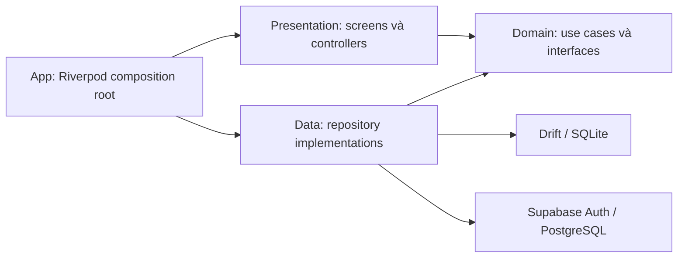
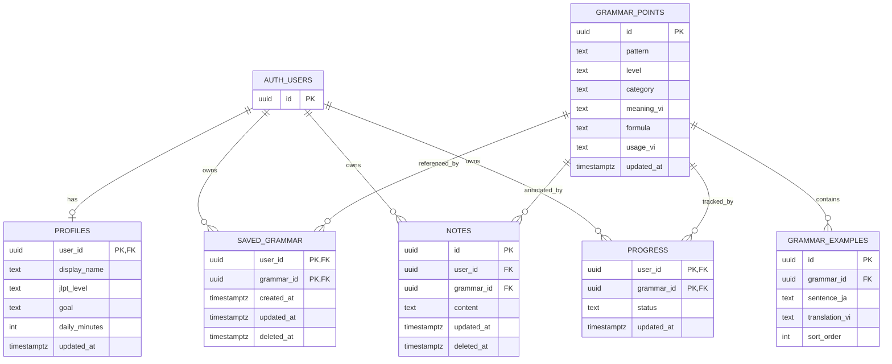

# BÁO CÁO MỐC 2 — KIẾN TRÚC CHI TIẾT VÀ TRIỂN KHAI CHỨC NĂNG LÕI

**Học phần:** Phát triển ứng dụng di động đa nền tảng (9) 
**Giảng viên:** TS. Nguyễn Thanh Tuấn 
**Đề tài:** Bunly — Ứng dụng học và tra cứu ngữ pháp tiếng Nhật từ nội dung thực tế 
**Nhóm:** Bunly • Học kỳ 1, năm học 2026–2027 
**Ngày cập nhật:** 29/10/2026 • **Mốc:** M2 — Tuần 8 theo template

| Thành viên | Mã sinh viên |
|---|---|
| Nguyễn Văn Hoàng | 23IT088 |
| Nguyễn Thị Ánh Vy | 23IT323 |
| Đoàn Nhật Ánh | 23IT.B007 |

> Trạng thái: đã bổ sung mã nguồn chức năng lõi; kiểm thử tự động Auth/API và Android đã đạt trên Supabase local. Báo cáo vẫn giữ các tình huống Cloud email, bàn phím/mạng thật, video và nội dung MVP chưa kiểm chứng hoặc chưa hoàn thành.

> **Rà baseline 09/11/2026:** xem [báo cáo A00](A00-Baseline-Audit-2026-11-09.md). Trên HEAD `3ae5be9625edaa3a761253a4e578daa416a97322` cùng working tree chưa commit, dependency lockfile, format, analyze và 24/24 unit/widget/SQLite tests vừa đạt. Local Docker chưa hoạt động, chưa có Android kết nối và Cloud đang INACTIVE; SQL/connected/Android/Cloud chưa chạy lại. Audit phát hiện screen phụ thuộc concrete cache repository và logout chưa đi qua use case, cần xử lý ở A03. Kết quả mới không thay thế bằng chứng hoặc gỡ các trạng thái chưa nghiệm thu M2 bên dưới.

## 1. CLEAN ARCHITECTURE IMPLEMENTATION

**Bổ sung A03-01 ngày 09/11/2026:** đã bỏ phụ thuộc concrete cache repository từ màn kho và đưa đăng xuất qua use case/controller. [Bản bàn giao A02/A03-01](A02-A03-01-Delivery-2026-11-09.md) ghi 30/30 tests trên HEAD `3ae5be9625edaa3a761253a4e578daa416a97322` cùng diff chưa commit; chưa phải kết quả CI hoặc kiểm thử connected/device mới. Nội dung 12 mẫu/24 câu mới là fixture chờ duyệt, không nâng số lượng kho thực tế đã phát hành từ 3 lên 12.

### 1.1. Phạm vi và luồng chức năng M2

Đăng ký/đăng nhập email → hồ sơ học tập → tìm/lọc kho N5–N4 → xem chi tiết → lưu mẫu, tạo/sửa/xóa ghi chú → cập nhật trạng thái học → xem thống kê → đọc lại dữ liệu cục bộ và đồng bộ khi có mạng.

Ứng dụng dùng Flutter 3.35.7/Dart 3.9.2 theo phiên bản pin; Riverpod 2.6.1, Drift 2.28.2 và Supabase Flutter 2.10.3. Chế độ demo dùng asset và namespace riêng; connected dùng Supabase Auth/API với bộ nhớ cục bộ. Demo không chứng minh xác thực hoặc đồng bộ từ xa.

### 1.2. Phân lớp và chiều phụ thuộc

| Lớp | Hiện thực | Bằng chứng mã nguồn |
|---|---|---|
| Presentation | Form Auth/hồ sơ; danh sách, chi tiết, lọc đã lưu; ghi chú và điều khiển tiến độ; trạng thái đồng bộ | `lib/features/*/presentation/` |
| Domain | Entity, repository interfaces, Authenticate, SearchGrammar, SaveNote, UpdateLearning | `lib/features/*/domain/` |
| Data | Adapter Supabase Auth/API, cache nội dung, lưu dữ liệu học tập và worker push/pull | `lib/features/*/data/` |
| Composition root | Riverpod lắp ghép dependency và vòng đời session/worker | `lib/app/providers.dart` |
| Local storage | Drift/SQLite version 2, migration bảo toàn dữ liệu version 1 | `lib/core/database/app_database.dart` và code sinh kèm |

Domain dùng Dart thuần; không import Flutter, Riverpod, Drift hoặc Supabase. Presentation gọi use case, đọc dữ liệu qua interface được DI cung cấp. Lớp app chọn implementation theo chế độ chạy. Thay đổi tài khoản tạo lại navigator để đóng các trang riêng của phiên trước.

Cấu trúc chính: `auth`, `grammar`, `learning`, mỗi feature có `presentation/domain/data`. Hồ sơ, lưu mẫu và tiến độ dùng chung hợp đồng dữ liệu học tập; không tạo các feature rỗng chỉ để trình bày kiến trúc.

### 1.3. Ví dụ xuyên suốt: ghi chú và đồng bộ

1. Màn chi tiết nhận nội dung; NoteController gọi SaveNote.
2. Use case trim và kiểm tra 1–2000 Unicode code points, rồi gọi LearningRepository.
3. LocalLearningRepository ghi ghi chú và thao tác outbox trong cùng transaction khi connected; demo chỉ ghi local.
4. Danh sách theo dõi Drift cập nhật UI. Sửa giữ nguyên note ID; xóa giữ tombstone và ẩn khỏi danh sách.
5. LearningSync gửi các thao tác tuần tự bằng phiên chủ sở hữu; retry dùng cùng ID. Chỉ xóa đúng sequence được server xác nhận.
6. Pull dữ liệu cá nhân sau push; nếu còn thao tác local cho cùng entity/key thì chưa ghi đè bằng dữ liệu server.

Có test SQLite thật cho transaction/rollback, lưu bền và migration; test remote giả lập cho timeout sau commit, thao tác mới trong lúc nhận acknowledgment, sửa trong lúc pull và đổi session. Tích hợp Supabase thật được kiểm tra riêng, không suy ra từ fake.

## 2. DATABASE SCHEMA & SECURITY POLICIES

### 2.1. ERD backend theo migration hiện có

Bằng chứng: `supabase/migrations/20261022000100_core_schema.sql`. Sáu bảng ứng dụng gồm profiles, grammar_points, grammar_examples, saved_grammar, notes, progress; auth.users thuộc hệ thống Auth.

- Trigger tạo hồ sơ sau đăng ký; trigger updated_at dùng thời gian server khi update.
- profiles kiểm tra N5/N4, daily_minutes từ 1–1440; progress có new/learning/review/mastered.
- notes giới hạn độ dài nội dung. saved_grammar và progress dùng khóa ghép chống trùng.
- FK nối tài khoản và mẫu ngữ pháp; index phục vụ truy vấn owner/grammar.
- Seed hiện có **3 mẫu minh họa: 2 N5 và 1 N4**. Mục tiêu kho MVP 80–120 mẫu chưa đạt; không xem dữ liệu minh họa là kho nội dung đã biên tập hoàn chỉnh.

### 2.2. SQLite và migration

| Bảng local | Mục đích và cách phân vùng |
|---|---|
| cached_grammar | JSON nội dung đã tải; khóa namespace + grammar_id |
| local_notes | Ghi chú, updated_at và deleted_at; khóa namespace + owner_id + note_id |
| personal_records | Payload hồ sơ/lưu mẫu/tiến độ; khóa namespace + owner_id + entity_table + record_id |
| sync_outbox | Sequence, namespace, owner_id, record_id, payload và entity_table; giữ thao tác chờ gửi |

Schema version 2 bổ sung deleted_at, entity_table và personal_records. Migration từ version 1 giữ nguyên ghi chú/outbox; thao tác cũ mặc định thuộc notes. Test nâng cấp chạy với dữ liệu version 1 đã tạo trước, kiểm tra dữ liệu cũ còn đọc được.

Payload JSON giúp giữ một hàng đợi dùng chung ở M2; entity và validation vẫn nằm trong domain/repository. M3 cần tiếp tục kiểm tra hợp đồng payload và schema migration khi mở rộng bài làm/lịch ôn.

### 2.3. RLS và cách ly dữ liệu

| Nhóm | Chính sách |
|---|---|
| Kho ngữ pháp và ví dụ | authenticated được đọc; client không được biên tập |
| Hồ sơ, lưu mẫu, ghi chú, tiến độ | SELECT/DELETE kiểm tra auth.uid() = user_id; INSERT dùng WITH CHECK; UPDATE dùng USING và WITH CHECK |
| Cache và outbox cá nhân | Phân vùng backend + user; truy vấn không lấy dữ liệu user khác |
| Worker | Kiểm tra owner trước/sau request; lấy access token của đúng owner cho request; dừng khi phiên thay đổi |
| Khóa bí mật | App dùng client key và phiên người dùng; không chứa service-role hoặc khóa LLM |

Bộ pgTAP đã được mở rộng kiểm tra saved_grammar/progress, tombstone và validation, ngoài các tình huống notes/profiles sẵn có. Đợt kiểm chứng CI mới đạt 39/39 SQL test; nguồn log trong biên bản kiểm chứng kèm theo.

Kết quả lịch sử ngày 22/10/2026: 18 kiểm tra RLS đạt và db lint không có lỗi trên PostgreSQL local, với JWT claims dưới vai trò authenticated. Kết quả này không thay cho bộ SQL mở rộng và Auth API của bản hiện tại.

### 2.4. Phạm vi đồng bộ M2

Worker hỗ trợ hồ sơ, lưu mẫu, ghi chú và tiến độ. Trigger khi mở kho, app trở lại foreground, mỗi 30 giây khi màn kho còn được giữ, hoặc thao tác Đồng bộ. Thao tác mới tạo trong một lượt gửi có thể tiếp tục chờ lượt sau; UI hiển thị số thao tác pending.

Mất mạng/lỗi quyền giữ outbox; timeout sau server commit có thể gửi lại theo khóa ổn định. Acknowledgment cũ không xóa thao tác mới. Các bản xóa notes/saved_grammar dùng tombstone. Dữ liệu tải xuống không ghi đè bản local đang pending.

Giới hạn: đây là cơ chế một thiết bị, chưa nghiệm thu xử lý xung đột đa thiết bị, hard-delete từ công cụ quản trị hoặc chạy nền khi app bị hệ điều hành đóng. M3 tiếp tục conflict resolution và vòng đời tombstone. UI không nhận đã đồng bộ khi lần gửi bị lỗi.

## 3. CORE FEATURE IMPLEMENTATION PROGRESS

### 3.1. Ma trận yêu cầu và bằng chứng

| ID | Code đã bổ sung/hiện có | Kiểm chứng và phần còn thiếu |
|---|---|---|
| FR-01 | Auth adapter/form; hồ sơ local-first, validation và sync | Auth SDK và Android connected với email xác nhận Mailpit local đạt; xác nhận thư Cloud và thao tác thủ công trên máy thật còn chờ |
| FR-02 | Tìm/lọc kết hợp, chi tiết, API/asset, cache và nhãn dữ liệu đã tải | Cache/API và Android demo/connected đạt; tìm bằng bàn phím thật còn chờ |
| FR-03 | Lưu/bỏ lưu, danh sách đã lưu, tạo/sửa/xóa ghi chú, local transaction | Repository/widget và thao tác Android đạt; kiểm tra văn bản dài/IME thật còn chờ |
| FR-04 | Bốn trạng thái và thống kê từ bản ghi của user trong catalog đã tải | Test lưu trạng thái/điều khiển UI; chưa có accuracy bài làm vì practice chưa triển khai |
| FR-05 | Push/pull tuần tự, retry, pending protection và tombstone | Remote giả lập, Supabase local thật và Android ngắt cổng API/reconnect đạt; bật máy bay/tắt Wi-Fi thật còn chờ |
| FR-06 | RLS backend, phân vùng cache/outbox, đổi session đóng trang riêng | 39 SQL test, SDK A/B và Android A/B đạt; tình huống đổi phiên giữa request trên thiết bị còn chờ thủ công |

### 3.2. Kết quả chạy và cách tái lập

| Kiểm tra | Kết quả mới nhất cần đối chiếu |
|---|---|
| Flutter/Dart | 3.35.7 / 3.9.2; đúng pin của repo |
| Code generation | Đã sinh lại app_database.g.dart bằng build_runner |
| Static analysis | Đạt: No issues found; log kiểm chứng cuối được ghi kèm |
| Unit/repository/widget | 24/24 đạt trên Windows: 21 domain/repository và 3 widget |
| Connected SDK test | 1/1 đạt lại trên máy local với Auth/API thật và hai tài khoản thử |
| Android demo | 1/1 đạt trên Samsung A11; dùng assets và SQLite thật |
| Android connected | 1/1 đạt trên Samsung A11 với Supabase local; signup/email, offline gateway/reconnect, sync và A/B |
| SQL/RLS | 39/39 đạt và db lint sạch trên Supabase local |
| APK | Bản connected Cloud build, cài và mở trên Samsung A11; APK demo được giữ riêng; hash trong biên bản |
| CI | Run 40790854357 đạt cả job Flutter/build APK và database/connected SDK cho commit 6449a26 |

Lệnh chính: build_runner, dart format, flutter analyze, flutter test; SQL dùng npm run db:lint và npm run db:test. Hướng dẫn môi trường và các lệnh đầy đủ ở `../development/GETTING_STARTED.md`. SDK connected dùng hai tài khoản local đã xác nhận sẵn; bài Android connected riêng đã đăng ký và xác nhận qua Mailpit local. Nhóm chưa tự xác nhận email thật trên Cloud.

### 3.3. Mã nguồn, video và cổng nghiệm thu

- Baseline trước đợt hoàn thiện: `d15909dec97da282c2643bbac93bac9babfc2b5b`.
- Nhánh triển khai: `codex/complete-m2`; commit kiểm chứng local `ea1f4f993a9567b02b68a76f458170ddc6a23879`. PR/CI remote hiện chưa chứa commit này; đối chiếu riêng kết quả CI trong biên bản.
- Tag milestone-2: chưa tạo khi còn tiêu chí chưa được kiểm chứng.
- Video 2–3 phút: chưa quay/chưa có URL. Kịch bản: Auth → hồ sơ → tra cứu → lưu/ghi chú/tiến độ → mở lại/offline → reconnect → đổi user.
- Android thật: hai bài integration tự động đã đạt trên Samsung A11 với backend local; bản connected Cloud đã cài/mở nhưng chưa kiểm thử đăng ký/đăng nhập bằng email thật. Không ghi nhận iOS đã kiểm thử.

Các trở ngại môi trường và kết quả cuối được ghi trong `M2-Verification-2026-10-29.md`. Báo cáo này không thay thế video do nhóm tự quay và checklist thao tác thủ công còn thiếu.

### 3.4. Chuyển tiếp M3

OCR tiếng Nhật, xác nhận/sửa văn bản, phát hiện ngữ pháp qua Edge Function/LLM, hạn mức server, conflict đa thiết bị, đánh giá AI và hiệu năng tiếp tục ở M3. Practice/lịch ôn, lộ trình đầy đủ, nhắc nhở và Free/Pro vẫn là các yêu cầu MVP phải theo dõi; không tự chuyển thành tùy chọn. Phân công chi tiết ở `../planning/TEAM-M2-M3-Delivery-Plan.md`.
