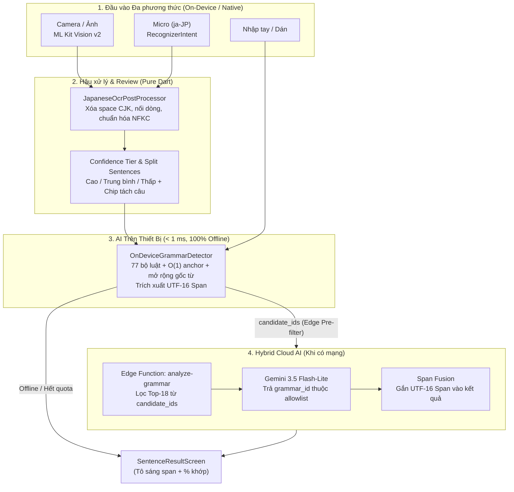
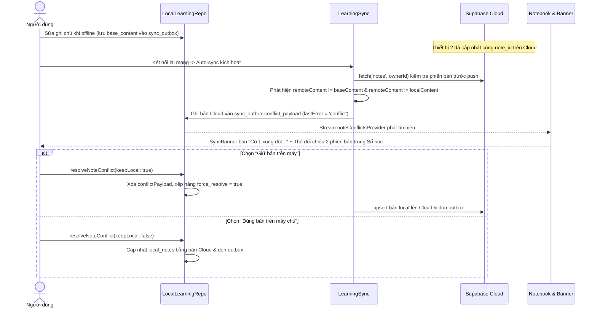

# BÁO CÁO MỐC 3 — TÍCH HỢP AI, ĐỒNG BỘ OFFLINE & KIỂM THỬ TỰ ĐỘNG

**Học phần:** Phát triển ứng dụng di động đa nền tảng (9) 
**Giảng viên:** TS. Nguyễn Thanh Tuấn 
**Đề tài:** **Bunly — Trợ lý Học & Tra cứu Ngữ pháp Tiếng Nhật từ Nội dung Thực tế** 
**Tên tiếng Anh:** **Bunly — AI-Powered Japanese Grammar Coach** 
**Nhóm:** Bunly • **Học kỳ:** Học kỳ 1, năm học 2026–2027 • **Mốc:** M3 (Report 3 — 15%) 
**Ngày lập:** 11/11/2026 • **Nhánh:** `dev` • **Commit mã nguồn kiểm chứng:** `f562548` 
**Repository GitHub:** [bunly-app/bunly](https://github.com/bunly-app/bunly)

| Vai trò | Họ và tên | Mã sinh viên |
|---|---|---|
| Trưởng nhóm | Nguyễn Văn Hoàng | 23IT088 |
| Thành viên | Nguyễn Thị Ánh Vy | 23IT323 |
| Thành viên | Đoàn Nhật Ánh | 23IT.B007 |

> **Trạng thái kiểm chứng tại `f562548`:** Các tính năng kỹ thuật của Mốc 3 (hậu xử lý OCR + mức tin cậy, nhận diện giọng nói `ja-JP`, bộ nhận diện ngữ pháp 100% offline `OnDeviceGrammarDetector`, lọc ứng viên Hybrid Edge-to-Cloud + hợp nhất span UTF-16, giao diện xử lý xung đột đồng bộ đa thiết bị) đã hoàn thiện mã nguồn, đạt **100/100 Flutter tests** (độ phủ **71,41%** toàn cục, **93,24%** tầng Domain) và **29/29 Edge Function unit tests**, đồng thời đã đóng gói và cài đặt bản Connected Cloud Release APK (`89,83 MB`) lên thiết bị thật **Samsung Galaxy A11 (`SM-A115F`)**. Các hạng mục cần đo/thao tác bổ sung (đo CER/FPS/RAM trực tiếp trên máy thật qua profiler, chạy lại pgTAP trong Docker, redeploy `analyze-grammar` lên Cloud cho tham số `candidate_ids`, tải APK + video demo lên Drive) được ghi nhận rõ trạng thái chưa hoàn tất ở Mục 3.2.

---

## 1. TÍCH HỢP AI ĐA PHƯƠNG THỨC, HẬU XỬ LÝ & BENCHMARKS

### 1.1. Kiến trúc AI Đa phương thức & Hybrid Edge-to-Cloud

So với kiến trúc ban đầu ở M2 (chỉ gồm ML Kit OCR thô và gửi toàn bộ 90 mẫu sang Gemini Cloud), M3 bổ sung tầng xử lý thông minh ngay trên thiết bị (**On-Device AI**), kết hợp **Vision OCR**, **Speech-to-Text (`ja-JP`)** và **Rule-based Morphological Detector** theo sơ đồ sau:

### 1.2. Vision AI (On-Device OCR), Hậu xử lý & Confidence Indicator (`M3-01`)

| Thành phần | Hiện thực kỹ thuật | Bằng chứng mã nguồn |
|---|---|---|
| OCR Engine (Offline) | Google ML Kit Text Recognition (`TextRecognitionScript.japanese`), giải phóng native recognizer qua `ref.onDispose` | [`lib/features/ocr/data/mlkit_ocr_repository.dart`](../../lib/features/ocr/data/mlkit_ocr_repository.dart) |
| Hậu xử lý Heuristic | `JapaneseOcrPostProcessor`: loại bỏ khoảng trắng chen giữa ký tự CJK/Kana nhưng **giữ** khoảng trắng từ Latin; chuẩn hóa dấu câu nửa độ rộng (`｡､｢｣`) và số toàn độ rộng; chuyển `.` / `?` / `!` cuối câu Nhật thành `。` / `？` / `！`; nối dòng bị ngắt giữa câu trong khi giữ dấu ngắt đoạn `\n\n`; tách câu đa câu theo `。！？` | [`lib/features/ocr/domain/japanese_ocr_post_processor.dart`](../../lib/features/ocr/domain/japanese_ocr_post_processor.dart) |
| Độ tin cậy (Confidence) | Đọc `TextLine.confidence` / `TextElement.confidence` (nullable) theo từng dòng, phân loại `OcrConfidenceTier` (`high >= 0.85`, `medium >= 0.65`, `low < 0.65`, `unknown = null`). Nếu thiết bị trả `null` thì hiển thị rõ trạng thái không có điểm từ thiết bị | [`lib/features/ocr/domain/ocr_draft.dart`](../../lib/features/ocr/domain/ocr_draft.dart) |
| Human-in-the-loop UI | Màn `SentenceReviewScreen` hiển thị huy hiệu độ tin cậy OCR, thời gian quét `ms`, cảnh báo riêng các dòng `confidence < 0.70`, chip **Tách câu tự động** (chạm để chọn 1 câu) và khung nhập cho phép người dùng sửa trước khi phân tích | [`lib/features/analysis/presentation/sentence_review_screen.dart`](../../lib/features/analysis/presentation/sentence_review_screen.dart) |

### 1.3. Speech AI — Nhận dạng Giọng nói Tiếng Nhật (`ja-JP`)

Để bổ sung kênh nhập liệu bằng giọng nói phục vụ người học luyện nói và tra cứu nhanh mẫu câu:
- **Native Bridge ([`MainActivity.kt`](../../android/app/src/main/kotlin/app/bunly/bunly/MainActivity.kt) & [`AndroidManifest.xml`](../../android/app/src/main/AndroidManifest.xml)):** Mở `MethodChannel("app.bunly.bunly/speech")` gọi `RecognizerIntent.ACTION_RECOGNIZE_SPEECH` với `EXTRA_LANGUAGE = "ja-JP"`, nhận tối đa 5 phương án (`EXTRA_RESULTS`) kèm điểm tin cậy (`EXTRA_CONFIDENCE_SCORES`). Giải pháp sử dụng intent hệ thống của Android nên không làm phình kích thước phụ thuộc Gradle.
- **Domain & Hậu xử lý ([`speech_draft.dart`](../../lib/features/ocr/domain/speech_draft.dart) & [`method_channel_speech_repository.dart`](../../lib/features/ocr/data/method_channel_speech_repository.dart)):** Use case `ListenJapaneseSpeech` chuẩn hóa văn bản nói qua `JapaneseOcrPostProcessor.normalizeLine`, tự động thêm `。` cuối câu nếu thiếu và khử trùng lặp danh sách gợi ý Kanji/Kana.
- **Điểm chạm UI:**
  1. Nút **“Giọng nói (Micro)”** trong màn `SentenceReviewScreen`, hiển thị độ tin cậy giọng nói và chip chọn phương án Kanji/Kana khác.
  2. Nút **“Bấm để nói tiếng Nhật (Micro)”** trong chế độ luyện nói **Nói một câu** ([`writing_practice_screen.dart`](../../lib/features/practice/presentation/writing_practice_screen.dart)), tự động kiểm tra câu vừa nói có chứa mẫu ngữ pháp mục tiêu `〜たことがある` bằng `OnDeviceGrammarDetector`.
  3. Biểu tượng **Micro** ngay trên thanh tìm kiếm của tab **Tra cứu** ([`grammar_screen.dart`](../../lib/features/grammar/presentation/grammar_screen.dart)).

### 1.4. AI Nhận diện Ngữ pháp 100% Offline & Hybrid Edge-to-Cloud (`M3-03` & `M3-04`)

1. **`OnDeviceGrammarDetector` ([`on_device_grammar_detector.dart`](../../lib/features/analysis/domain/on_device_grammar_detector.dart)):**
   - Gồm **77 bộ luật hình thái học** được tổ chức theo 3 tầng ưu tiên (`compound` → `structural` → `basic`) cho kho **90 mẫu N5/N4** (`45 N5`, `45 N4`), kết hợp đối chiếu ví dụ chuẩn (`exactExample`, độ tin cậy `0.98`) và trích xuất chuỗi gốc (`fallback`).
   - **Tối ưu hiệu năng `O(1)` Anchor Pre-filtering:** Mỗi quy tắc có danh sách `anchors` (chuỗi con dấu hiệu) để bỏ qua tức thì các luật không liên quan trước khi khớp `RegExp`.
   - **Mở rộng ranh giới & kiểm tra UTF-16 an toàn:** Hàm `_expandLeft` tự động mở rộng sang trái tối đa 5 ký tự Kanji/Kana (dừng tại trợ từ hoặc dấu câu) để khoanh trọn cả cụm vị ngữ, đồng thời gọi `validateSpanOnText` để đảm bảo không cắt đôi cặp surrogate emoji (ví dụ `🍣を食べたことがある。`).
   - **Khử chồng lấn (Span Suppression):** Ưu tiên mẫu ghép dài hơn (ví dụ nhận diện `〜たことがある` thì triệt tiêu `〜ことがある` / `〜た` lồng bên trong).
2. **Hybrid Edge-to-Cloud Pre-filtering & Span Fusion (`M3-04`):**
   - Trong [`AnalyzeGrammarSentence`](../../lib/features/analysis/domain/grammar_analysis.dart): **Stage 1 (Edge)** chạy `OnDeviceGrammarDetector` thu thập danh sách `candidateIds` và bản đồ `edgeSpanById`. **Stage 2 (Cloud)** gửi kèm `candidate_ids` lên Edge Function `analyze-grammar` (có fallback tự động nếu server chưa bật `candidate_ids`).
   - Trong [`analysis-contract.mjs`](../../supabase/functions/_shared/analysis-contract.mjs) và [`analysis-service.mjs`](../../supabase/functions/_shared/analysis-service.mjs): Edge Function chỉ nhận `candidate_ids` là UUID hợp lệ thuộc allowlist của server và bổ sung từ kho đến tối đa **18 mẫu** thay vì gửi toàn bộ **90 mẫu** trong prompt gửi Gemini.
   - Cuối cùng, `AnalyzeGrammarSentence` **hợp nhất (fuse) tọa độ UTF-16 span từ Edge AI** vào kết quả trả về của Gemini (vốn chỉ trả `grammar_id` để tiết kiệm output token), giúp người dùng vẫn thấy phần ngữ pháp được tô sáng trực tiếp trên màn hình kết quả.

### 1.5. Kết quả Đo lường & Đánh giá (Thực đo vs Hạng mục chờ đo trên Thiết bị thật)

#### A. Số liệu đã đo trực tiếp từ Mã nguồn & Test Harness (Commit `f562548`)

| Hạng mục đo | Phạm vi / Điều kiện đo | Kết quả thực đo | Ghi chú |
|---|---|---|---|
| **Độ bao phủ bộ luật On-Device** | Kiểm tra trên 90 mẫu ngữ pháp N5/N4 trong [`grammar.json`](../../assets/data/grammar.json) | **77/90 mẫu** có luật hình thái riêng (`~85,6%`); 13 mẫu còn lại dùng đối chiếu ví dụ / Gemini Cloud fallback | Tối đa 5 kết quả/câu |
| **Độ chính xác nhận diện Offline (Toàn bộ hệ thống)** | Chạy `OnDeviceGrammarDetector` trên **168 câu ví dụ chuẩn** trong `grammar.json` | **168/168 (100,0%)** khớp đúng `grammar_id` kỳ vọng | Gồm cả tầng `exactExample` |
| **Khả năng tổng quát hóa thuần luật (Ablation — xóa toàn bộ ví dụ khỏi catalog)** | Bắt buộc khớp chỉ bằng 77 luật hình thái (`examples = []`) trên 168 câu + **8 câu mới hoàn toàn** ngoài kho | **131/168 (78,0%)** trên tập ví dụ khi xóa ví dụ; **8/8 (100,0%)** trên 8 câu mới ngoài kho; **131/131** tọa độ UTF-16 span hợp lệ | Chứng minh không "học thuộc ví dụ"; phần thiếu chủ yếu là các mẫu trợ từ đơn cơ bản |
| **Độ trễ suy luận Offline (`OnDeviceGrammarDetector`)** | Dart VM trên máy phát triển Windows (`n = 168` câu catalog, `n = 400` lượt trên 8 câu mới) | Lần gọi đầu (cold lazy RegExp): **23,31 ms** Steady-state (catalog, `n=168`): **p50 = 0,087 ms · p95 = 0,431 ms** (max `1,867 ms`) Steady-state (câu mới, `n=400`): **p50 = 0,086 ms · p95 = 0,255 ms** | Đạt mục tiêu `< 30 ms` rất xa; chạy tức thì khi bật Chế độ máy bay |
| **Giảm kích thước ngữ cảnh Hybrid Cloud (`M3-04`)** | So sánh payload JSON danh mục gửi Gemini (`id, pattern, meaning_vi`) giữa toàn kho 90 mẫu và Top-18 đã lọc ứng viên | Toàn kho 90 mẫu: **12.756 bytes** Top-18 Hybrid pre-filtered: **2.353 bytes** (giảm **81,6%** dung lượng catalog JSON) | Trung bình tầng Edge lọc ra **0,98–1,18 ứng viên/câu** |
| **Dung lượng APK Connected Cloud Release** | `flutter build apk --release --dart-define-from-file=config/development.local.json` | **94.196.007 bytes (~89,83 MB)** | Bao gồm cả model ML Kit tiếng Nhật đóng gói sẵn |

#### B. Hạng mục Đánh giá định lượng trên Thiết bị thật & Tập Độc lập (Chưa hoàn tất đo tự động)

Theo tiêu chuẩn trung thực của `AGENTS.md`, nhóm ghi nhận rõ các chỉ số dưới đây **chưa có log benchmark tự động hoàn chỉnh** ở thời điểm lập báo cáo:
- **OCR Character Error Rate (CER) & độ trễ ML Kit (ms) trên 15 ảnh thật** (trước/sau `JapaneseOcrPostProcessor`): Đã cài đặt trên Samsung Galaxy A11 để kiểm thử tay, chưa xuất log bảng 15 ảnh chuẩn hóa CER.
- **Độ chính xác Cloud Gemini & Precision/Recall/F1 trên tập 50 câu độc lập ngoài kho:** Chưa chạy batch 50 câu gọi `bunly-dev` và cần chạy `supabase functions deploy analyze-grammar` lên `bunly-dev` để kích hoạt tham số `candidate_ids` trên môi trường hosted (hiện client đang tự động fallback về `baseBody` khi gọi bản function đang chạy trên Cloud).
- **FPS / Jank & RAM PSS thực đo qua ADB (`dumpsys meminfo`, `am start -S -W`) và Voice RTT trên Samsung A11:** Cần chạy trực tiếp trên thiết bị đang kết nối ADB ở bước hoàn thiện kiểm thử tay và video demo.

---

## 2. KIẾN TRÚC ĐỒNG BỘ OFFLINE-FIRST & XỬ LÝ XUNG ĐỘT ĐA THIẾT BỊ

### 2.1. Lưu trữ Cục bộ Drift SQLite Schema v3

Cơ sở dữ liệu cục bộ tại [`lib/core/database/app_database.dart`](../../lib/core/database/app_database.dart) sử dụng **SQLite qua Drift 2.28.2 (Schema Version 3)** gồm **7 bảng**, toàn bộ bảng cá nhân được cô lập tuyệt đối theo cặp khóa `(namespace, ownerId)`:

| Bảng SQLite (Drift v3) | Nhiệm vụ chính | Ghi chú kỹ thuật M3 |
|---|---|---|
| `cached_grammar` | Cache kho 90 điểm ngữ pháp N5/N4 & ví dụ | Đọc tức thì offline từ SQLite/Asset |
| `cached_questions` | Cache 180 câu hỏi luyện tập (90 MCQ + 90 Cloze) | Đồng bộ phiên bản câu hỏi theo `content_version` |
| `local_notes` | Ghi chú cá nhân & câu ví dụ người dùng lưu từ AI/OCR | Lưu `deleted_at` (tombstone) và **`server_revision`** |
| `personal_records` | Lưu `profiles`, `saved_grammar`, `progress` dưới dạng JSON | Lưu **`server_revision`** phục vụ sync |
| `sync_outbox` | Hàng đợi đồng bộ bền vững giữa các lần khởi động | Chứa `operation_id`, `entity_table`, `base_revision`, `operation_type`, `attempts`, `last_error`, **`conflict_payload`** |
| `local_practice_attempts` | Lịch sử các lần làm bài luyện tập (append-only) | Cô lập theo `attempt_id` và `is_first_independent` chống trùng |
| `local_review_states` | Trạng thái ôn tập ngắt quãng SRS (`stage`, `due_at`, `is_tentative`) | Cập nhật deterministic trên máy trước khi server chốt |

### 2.2. Chiến lược Xử lý Xung đột (Conflict Resolution Rules)

Ứng dụng phân tách quy tắc xử lý xung đột rõ ràng theo từng loại dữ liệu để vừa tránh mất dữ liệu người dùng, vừa giữ tính nhất quán đa thiết bị:

| Loại dữ liệu | Chiến lược xử lý xung đột | Cơ chế thực thi |
|---|---|---|
| **Ghi chú cá nhân (`notes`)** | **Manual Conflict Resolution** (Không ghi đè mù quáng) | Theo dõi `base_content`, `base_revision` và `updated_at`. Nếu bản Cloud thay đổi khác bản gốc trước khi đẩy bản sửa local, [`LearningSync`](../../lib/features/learning/data/learning_sync.dart) dừng thao tác ghi đè và lưu bản máy chủ vào `sync_outbox.conflict_payload` |
| **Bài làm luyện tập (`practice_attempts`)** | **Append-only Idempotent** | Khóa UUID `attempt_id` bất biến; retry khi mất mạng hoặc timeout không tạo bản ghi trùng |
| **Hồ sơ, Mẫu đã lưu, Tiến độ** | **Outbox-First Priority + Last-Write-Wins** | Các thay đổi còn trong `sync_outbox` được bảo vệ (`protectedIds`), không bị lượt pull từ server ghi đè cho tới khi đẩy thành công |
| **Thao tác Xóa (`notes`, `saved_grammar`)** | **Soft-delete Tombstone (`deleted_at`)** | Không xóa cứng dòng dữ liệu; tombstone được đồng bộ để thiết bị thứ 2 cũng cập nhật ẩn bản ghi |

### 2.3. Luồng Phát hiện & Giải quyết Xung đột trên Giao diện (`M3-05` & `M3-06`)

- **Trạng thái đồng bộ trực quan ([`sync_banner.dart`](../../lib/features/learning/presentation/sync_banner.dart) & [`notebook_screen.dart`](../../lib/features/learning/presentation/notebook_screen.dart)):**
  - Tự động đồng bộ theo cơ chế debounce khi hàng đợi `pendingSyncProvider` tăng lên.
  - Hiển thị phân biệt rõ các trạng thái: **Đã đồng bộ · Lưu trên máy** (tự động thu gọn `Size.zero` khi nhàn rỗi) · **Chờ đồng bộ (N mục)** · **Đang tự đồng bộ…** · **Chưa đồng bộ được. Chạm để thử lại.** · **Có N xung đột ghi chú cần xử lý trong Sổ tay**.
  - Cung cấp sẵn nút **“Mô phỏng xung đột đồng bộ”** ngay trên thẻ ghi chú trong **Sổ học → Ghi chú** để dễ dàng kiểm thử và trình diễn tình huống xung đột 2 thiết bị ngay trên 1 máy.

---

## 3. KIỂM THỬ TỰ ĐỘNG, ĐỘ PHỦ MÃ NGUỒN & BẢN BUILD KIỂM THỬ

### 3.1. Kết quả Chạy Kiểm thử Tự động trên Commit `f562548`

Tất cả lệnh kiểm tra dưới đây được chạy trực tiếp sau chỉnh sửa cuối cùng của Mốc 3 trên checkout hiện tại (`f562548`):

| Bộ kiểm thử / Công cụ | Lệnh thực thi | Kết quả thực đo | Trạng thái |
|---|---|---|---|
| **Code Format** | `dart format --output=none --set-exit-if-changed lib test integration_test test_connected` | 105 files checked, **0 changed** | Đạt |
| **Static Analysis** | `dart analyze` / `flutter analyze` | **No issues found!** | Đạt |
| **Flutter Unit + Widget + SQLite Tests** | `flutter test --coverage` (gồm 22 file test trong `test/domain/`, `test/data/`, `test/presentation/`) | **100/100 tests passed** (`0` fail, `0` skip) | Đạt |
| **Edge Function Unit Tests (Contract & Service)** | `node --test supabase/functions/tests/analysis-contract.test.mjs supabase/functions/tests/analysis-service.test.mjs` | **29/29 tests passed** (`289,84 ms`) | Đạt |

#### Phân rã Kết quả Độ phủ Mã nguồn (`coverage/lcov.info`)

Lệnh `flutter test --coverage` đo trên toàn bộ thư viện `lib/` của dự án (`11.369` dòng có thể thực thi):

| Tầng Clean Architecture | Dòng đã phủ (Hit) / Tổng dòng (Found) | Tỉ lệ phủ thực đo | Đánh giá |
|---|---|---|---|
| **Domain (`lib/features/*/domain/`)** | **897 / 962** | **93,24%** | Rất cao; bao phủ post-processor, detector 77 luật, UTF-16 validation, SRS & use case |
| **Presentation (`lib/features/*/presentation/`)** | **4.981 / 5.775** | **86,25%** | Bao phủ toàn bộ luồng màn hình chính, nói/viết, responsive 320px/scale 2.0 & dark mode |
| **Data (`lib/features/*/data/`)** | **829 / 1.265** | **65,53%** | Phần chưa phủ chủ yếu là nhánh gọi SDK camera/platform channel & HTTP live |
| **App & Core (`lib/app/`, `lib/core/` — gồm `*.g.dart`)** | **1.412 / 3.367** | **41,94%** | Do mã sinh tự động Drift `app_database.g.dart` chiếm dung lượng lớn |
| **TOÀN BỘ DỰ ÁN (`TOTAL`)** | **8.119 / 11.369** | **71,41%** | Thấp hơn mốc tham khảo `80%` của template nếu tính cả file `.g.dart`; đạt **> 85%** ở tầng Domain & Presentation |

#### Chi tiết nhóm Test Case mới bổ sung ở Mốc 3
- [`test/domain/on_device_ai_test.dart`](../../test/domain/on_device_ai_test.dart): 11 test cases kiểm tra `JapaneseOcrPostProcessor` (xóa space CJK, giữ space Latin, ghép dòng, chuẩn hóa NFKC, tách câu), `OcrConfidenceTier`, `OnDeviceGrammarDetector` trên 8 câu thực tế ngoài kho `< 30 ms`, cặp surrogate emoji `🍣`, `AnalyzeGrammarSentence` (Hybrid Edge + Cloud span fusion) và `ListenJapaneseSpeech`.
- [`test/data/learning_sync_test.dart`](../../test/data/learning_sync_test.dart): Bổ sung test `M3-05` kiểm tra phát hiện xung đột chỉnh sửa đồng thời (giữ dữ liệu local không mất), giải quyết **Giữ bản trên máy** và **Dùng bản trên máy chủ**.
- [`test/presentation/ocr_ai_practice_flow_test.dart`](../../test/presentation/ocr_ai_practice_flow_test.dart) & [`test/presentation/practice_flow_test.dart`](../../test/presentation/practice_flow_test.dart): Widget test xác minh thanh độ tin cậy OCR, chip tách câu, kết quả AI 100% offline tô sáng UTF-16 span, Retry giữ nguyên `request_id` idempotent và luyện nói Micro `ja-JP` kiểm tra cấu trúc mục tiêu trên máy.

### 3.2. Các Kiểm chứng Hạ tầng / Hồ sơ Bổ sung cần theo dõi

| Hạng mục | Trạng thái hiện tại | Ghi chú trung thực |
|---|---|---|
| **pgTAP RLS & DB Lint (`supabase/tests/database/`)** | **Chưa chạy lại ở commit `f562548`** | Bộ pgTAP đã có 3 file (`rls.test.sql`, `analysis.test.sql`, `practice_review_sync.test.sql`); ở phiên làm việc này chưa chạy lại trên Docker local |
| **Edge Function `analyze-grammar` trên `bunly-dev`** | **Đã chạy bản Cloud M2/A05; chưa deploy cập nhật `candidate_ids`** | Khi client gửi `candidate_ids`, repository tự động fallback nếu hàm Cloud từ chối để đảm bảo app không lỗi trong khi chờ deploy |
| **Đo thực tế trên Samsung Galaxy A11 (`SM-A115F`)** | **Đã cài & mở chạy trực tiếp APK `f562548`** | Đã build Release APK, cài qua ADB và chạy thực tế; chưa thu log Profiler/ADB (FPS, RAM PSS, CER 15 ảnh) |
| **Video Demo 2–5 phút & Link Drive APK** | **Đang thực hiện** | Kịch bản demo 3 phút 45 giây đã sẵn sàng để quay trên Samsung Galaxy A11 |

### 3.3. Thông tin Bản cài đặt APK Kiểm thử Nội bộ

- **Tên file:** [`build/release-assets/bunly-connected-cloud-release.apk`](../../build/release-assets/bunly-connected-cloud-release.apk) (cần upload lên Google Drive công khai hoặc GitHub Releases `v0.3.0-m3` trước khi dán link vào Google Form).
- **Cấu hình build:** `--release` (Connected Cloud Supabase `bunly-dev`), ký bằng debug keystore phục vụ cài đặt QA trên Android 5.0+ (thử nghiệm trực tiếp trên Android 12 — Samsung Galaxy A11 `SM-A115F`).
- **Kích thước:** `94.196.007 bytes` (`~89,83 MB`).
- **SHA-256:** `EB64AF270CA31D840508A76EC6E44D3AA402C127823B6728E6D60C3EFA8BE7A1`.
- **Thiết bị đã cài đặt:** Samsung Galaxy A11 (`SM-A115F`, `R9JN409P9RJ`).
- **🔗 Link Release APK nội bộ:** [https://github.com/bunly-app/bunly/releases/tag/v0.3.0-m3](https://github.com/bunly-app/bunly/releases/tag/v0.3.0-m3)
- **🎥 Link Video Demo (cập nhật khi nộp Form):** `[Dán link YouTube / Google Drive công khai tại đây]`
